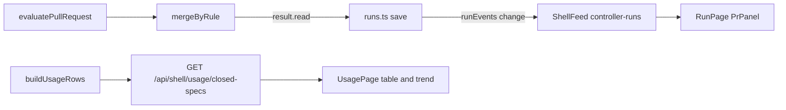

# Design Document

## Overview

This design adds three dashboard views: a PR panel on the Run page fed by the merge rule's own reads, an `owner` on each deferral record with a chip and a filter, and a closed-spec W-per-task table and trend on the Usage page. The PR reads ride the run record and the existing `controller-runs` push; the owner rides the deferral frontmatter and the existing `deferrals-update` push; the usage rows come from one new read-only route. It reuses the merge evaluation pass, the run-record `save`, the deferral storage, the `harness usage` fold, the Specs-page closed rule, `readAgentRules`, `FileCache` and the shell primitives.

## Steering Document Alignment

### Technical Standards (tech.md)
`.spec-workflow/steering/` is empty, so the design follows `agent-rules.md`: tests sit in `__tests__/` next to each module and run with `npx vitest run`, and no test asserts `child_process`, `fs` or stream fields beyond what the existing suites already assert.

### Project Structure (structure.md)
No structure.md exists; the one new server module goes beside its siblings in `src/dashboard/shell/`, and the one new frontend component beside `UsagePage.tsx`.

### Design System (design-system.md) — if applicable
N/A: the project has no design-system.md. The new UI uses the existing theme tokens (`src/dashboard_frontend/src/modules/theme/theme.css:97-108` light, `:172-183` dark) and the shell primitives `Group`, `Chips`, `Row` (`src/dashboard_frontend/src/modules/shell/primitives.tsx:12-102`).

## Architecture

Three independent slices share no new code. Slice 1 extends the merge evaluation pass to return the CI state, the raw `mergeable` and the PR URL it already read, puts a `PrRead` on every `MergeStageResult` that has a PR number, and saves it on the run record at the two merge call sites; `toRow` carries it to the wire and the Run page renders it. Slice 2 adds `owner` to the deferral record, its storage, the `deferrals` tool and the Deferrals page. Slice 3 adds a positive-integer `baseline-w-per-task` key to `readAgentRules`, a `buildUsageRows` builder over `FileCache`, one route, and a table plus a plain-SVG trend on the Usage page.



## Components and Interfaces

### C1 — Merge read (`src/controller/merge.ts`)
- **Purpose:** Return what the merge pass read, with no second GitHub call (R1 AC1-AC4, AC12).
- **Interfaces:**
  - `PR_VIEW_FIELDS` (`src/controller/merge.ts:38-39`) gains `url`. Probe: `gh pr view --json` under gh 2.95.0 lists `url` among its fields. The view call count stays one per pass.
  - New export `evaluatePullRequest(pr: PullRequest, now?: () => Date): Promise<{ evaluation: MergeEvaluation; ci: CiState['state']; mergeable?: string; url?: string }>`. It holds the body of `evaluate` (`src/controller/merge.ts:291-372`) unchanged and adds the three observed fields.
  - `evaluate(pr, now)` keeps its signature and returns `(await evaluatePullRequest(pr, now)).evaluation`, so its returned object has exactly the keys and values it has at base.
  - `MergeStageResult` (`src/controller/merge.ts:98-107`) gains optional `read?: PrRead` (C2).
  - `mergeByRule` (`src/controller/merge.ts:526-586`) calls `evaluatePullRequest` in place of `evaluate` and sets `read` on every return; `runMergeStage`'s no-PR return (`src/controller/merge.ts:515-517`) has no `read`.
- **Post-conditions:**
  - `ci` is `unreadable` on each of the four early returns (`src/controller/merge.ts:297-321`). Else it uses two flags of its own: `ciFailed` is set by a `failed` workflow run or status; `ciPending` is set by a `pending` run or status or the fresh-head rule (`src/controller/merge.ts:323-345`). `ci` is `red` if `ciFailed`, else `pending` if `ciPending`, else `green`. `mergeable=UNKNOWN` (`src/controller/merge.ts:347-351`) sets the evaluation's `pending` but not `ciPending`.
  - `mergeable` is the raw `data.mergeable` string whenever the `gh pr view` output parsed. It is absent when the view failed or did not parse (`src/controller/merge.ts:297-305`), never copied from an earlier read.
  - `url` is `pr.url` when set, else `data.url` when it is a string. The `read` keeps it only when it starts with `https://`.
  - `read.verdict` equals the returned `status`, `read.reasons` is the same array as the returned `reasons`, `read.sha` equals the returned `sha`, `read.at` is `deps.now()` ISO, `read.repo` is `basename(pr.repoDir)` as `closeoutMergeTarget` does (`src/controller/merge.ts:457-460`), and `read.kind` is `run` when `target.questionId` is `merge` and `closeout` otherwise.

### C2 — PR reads on the run record (`src/controller/state.ts`, `src/controller/runs.ts`)
- **Purpose:** Persist one read per PR and put it on the wire (R1 AC1, AC5, AC6, AC9, AC13).
- **Interfaces:**
  - `PrRead` and `PrCiState` are new exports of `state.ts`; `RunRecord` (`src/controller/state.ts:64-95`) gains optional `prReads?: PrRead[]`.
  - New export `withPrRead(reads: PrRead[] | undefined, read: PrRead): PrRead[]` in `runs.ts`. It replaces the entry with the same `repo` and `number`, else appends, then stable-sorts `kind: 'run'` entries first.
  - `runMergeStageStep` (`src/controller/runs.ts:599-682`): right after `runMergeStage` returns (`src/controller/runs.ts:626-632`) and before the `switch`, when `result.read` is set, `run = await save(deps, run, { prReads: withPrRead(run.prReads, result.read) })`. Every branch then saves from that `run`, so no branch drops the reads.
  - `runCloseoutMergeStep` (`src/controller/runs.ts:903-937`): inside the loop, after each `mergeByRule` (`src/controller/runs.ts:912`), the same save with that PR's read. Each close-out read shows as soon as its pass ends.
  - `ControllerRunRow` and `toRow` (`src/controller/runs.ts:1175-1196`) gain `prReads?: PrRead[]`, copied from `run.prReads` and left `undefined` when the record has none. `PrRead` holds no path, so the row stays path-free.
- **Dependencies:** C1.
- **Reuses:** `save` (`src/controller/runs.ts:521-526`), the one write path that emits `runEvents` `change`. The hub turns that into a feed schedule (`src/dashboard/harness/hub.ts:49`, `:161-163`), and the feed flushes `controller-runs` within its 1000 ms default throttle (`src/dashboard/shell/shell-feed.ts:39`), inside the 5 s of R1 AC9. The run loop re-reads the record after each merge step (`src/controller/runs.ts:725-726`, `:759-761`), so a later save keeps the reads.

### C3 — Wire hand copies (`src/dashboard/shell/types.ts`, `src/dashboard_frontend/src/modules/shell/types.ts`)
- **Purpose:** Keep the three row shapes in step (R1 AC6).
- **Interfaces:** Both `ControllerRun` types (`src/dashboard/shell/types.ts:137-150`; `src/dashboard_frontend/src/modules/shell/types.ts:167-179`) gain `prReads?: ControllerPrRead[]`, a hand copy of `PrRead`. The server file also gains `UsageSpecRow` (C9), and the frontend file gains its hand copy.

### C4 — PR panel (`src/dashboard_frontend/src/modules/shell/RunPage.tsx`)
- **Purpose:** Show the reads (R1 AC7, AC8, AC10, AC11).
- **Interfaces:** New component `PrPanel({ reads }: { reads: ControllerPrRead[] })`. It is mounted after `LiveNow` (`src/dashboard_frontend/src/modules/shell/RunPage.tsx:176-186`) when `ctrlRun?.prReads?.length` is above 0, else not rendered.
- **Post-conditions:** The panel has `data-testid="pr-panel"`. Each row has `data-testid="pr-row-{repo}-{number}"` and shows, in order:
  - the repository name;
  - `#number` as an anchor to `url` when the url starts with `https://`, else plain text;
  - a CI chip `data-testid="pr-ci-{repo}-{number}"` coloured `--status-success`, `--status-warning`, `--status-error` or `--status-pending` for `green`, `pending`, `red`, `unreadable`;
  - `mergeable`, or `—` when it is absent;
  - the verdict, followed by `sha.slice(0, 7)` when the verdict is `merged`;
  - each reason as its own line;
  - `formatDate(at, { includeSeconds: true })` (`src/dashboard_frontend/src/lib/dateUtils.ts:13-41`).

  The panel makes no fetch.

### C5 — Deferral owner storage (`src/types.ts`, `src/core/deferral-storage.ts`)
- **Purpose:** Store and read `owner` (R2 AC1, AC2, AC5, AC6, AC8).
- **Interfaces:**
  - `export type DeferralOwner = 'matthew' | 'harness'`. `Deferral` (`src/types.ts:310-330`) gains optional `owner?: DeferralOwner | null`, so `create`'s parameter type (`src/core/deferral-storage.ts:218-221`) accepts it without forcing existing callers.
  - `serializeFrontmatter` (`src/core/deferral-storage.ts:42-62`) writes `owner: "matthew"` or `owner: "harness"` after the `supersedes` line only when `owner` is one of the two. It writes no `owner` line otherwise.
  - `parseMarkdown` (`src/core/deferral-storage.ts:125-165`) sets `owner` to the scalar when it is `matthew` or `harness`, else `null`.
  - `update`'s `updates` (`src/core/deferral-storage.ts:310-329`) gains `owner?: DeferralOwner`.
- **Post-conditions:** A record with no `owner` key serializes byte-identical to base, so `reindex` (`src/core/deferral-storage.ts:428-470`) rewrites no legacy file. `resolve`, `merge` (`src/core/deferral-storage.ts:352-372`) and `update` load and re-serialize the whole record, so `owner` survives. No read path writes.

### C6 — `deferrals` tool owner (`src/tools/deferrals.ts`, `docs/TOOLS-REFERENCE.md`)
- **Purpose:** Set and return `owner` (R2 AC3, AC4, AC7).
- **Interfaces:**
  - The schema (`src/tools/deferrals.ts:22-104`) gains `owner: { type: 'string', enum: ['matthew', 'harness'] }`, described as optional for add and update. The tool description's update list (`src/tools/deferrals.ts:18`) names `owner`.
  - A shared check runs first in `handleAdd` (`src/tools/deferrals.ts:150-190`) and `handleUpdate` (`src/tools/deferrals.ts:254-275`). When `args.owner !== undefined` and it is neither value, it returns `{ success: false, message: "owner must be 'matthew' or 'harness'" }` before any storage call.
  - `handleAdd` passes `owner: args.owner ?? null` to `create`. `handleUpdate`'s key list adds `owner`, and so does its "Updatable" message.
  - `handleList`'s summary (`src/tools/deferrals.ts:199-207`) adds `owner: d.owner ?? null`. `get` returns the parsed record, which always carries `owner`.
  - The action table (`docs/TOOLS-REFERENCE.md:370-376`) lists `owner` for `add` and `update`.

### C7 — Deferrals page owner (`src/dashboard_frontend/src/modules/shell/DeferralsPage.tsx`)
- **Purpose:** Show the owner chip, the field and the filter (R2 AC9-AC12).
- **Interfaces:**
  - `FullDeferral` (`src/dashboard_frontend/src/modules/shell/DeferralsPage.tsx:23-33`) gains `owner?: 'matthew' | 'harness' | null`.
  - A new `activeOwners: string[]` state and a second `Chips` row hold the values `matthew`, `harness` and `none`, labelled `matthew`, `harness` and `no owner`. Each count spans every enabled project's records, computed like `statusCounts` (`src/dashboard_frontend/src/modules/shell/DeferralsPage.tsx:75-84`).
  - The `items` filter (`src/dashboard_frontend/src/modules/shell/DeferralsPage.tsx:87-103`) adds this rule: when `activeOwners` is non-empty, keep a record only if `activeOwners` includes `d.owner ?? 'none'`. The page reset effect (`src/dashboard_frontend/src/modules/shell/DeferralsPage.tsx:106`) adds `activeOwners`.
  - A row with an owner shows a badge `data-testid="deferral-owner-{projectId}-{id}"` after `StatusBadge`. `DeferralPanel` adds `Field label="Owner"`; `Field` already hides an empty value (`src/dashboard_frontend/src/modules/shell/DeferralsPage.tsx:196-204`).
- **Post-conditions:** The page adds no control that writes. The `deferrals-update` push refreshes counts, rows and panel through `deferralsByProject`, as it does at base.

### C8 — Baseline key (`src/dashboard/harness/run-setup.ts`, `docs/SDD-HARNESS.md`)
- **Purpose:** Read the repository baseline (R3 AC9).
- **Interfaces:** `AgentRules` (`src/dashboard/harness/run-setup.ts:32-43`) gains optional `baselineWPerTask?: number`. `readAgentRules` (`src/dashboard/harness/run-setup.ts:66-127`) sets it from `/^baseline-w-per-task:\s*([1-9]\d*)\s*$/m`; otherwise the key is omitted, including for a missing file. The key table (`docs/SDD-HARNESS.md:252-269`) gains a row: `baseline-w-per-task: <n>`, read by the Usage page, meaning the repository's W per task baseline.

### C9 — Usage rows (`src/dashboard/shell/usage-rows.ts`, new; `src/dashboard/shell/spec-rows.ts`)
- **Purpose:** One row per closed spec of one project (R3 AC1-AC9).
- **Interfaces:**
  - `spec-rows.ts` exports `isSpecClosed(phaseRows: PhaseRow[], planText: string | undefined): boolean`, the rule at `src/dashboard/shell/spec-rows.ts:92-93` over `firstStatusValue` (`src/dashboard/shell/spec-rows.ts:52-60`). `buildSpecRows` calls it in place of those two lines, with no behaviour change.
  - New `buildUsageRows(project: ProjectContext, cache: FileCache): Promise<UsageSpecRow[]>`. It walks the `IndexGenerator` snapshot as `buildSpecRows` does (`src/dashboard/shell/spec-rows.ts:72-86`) and keeps each entry where `isSpecClosed` is true.
- **Post-conditions per row:**
  - `closeDate`: the `date` of the newest row with phase `closeout` and result `closed` from `parseHandoffPhaseRows(cache.text(handoffPath(workflowRoot)), spec)` (`src/watch/ledger.ts:201-218`), with no window. If there is no such row, the newest ledger `ts`. If there is neither, `null`.
  - `report = buildUsageReport(cache.jsonl(ledgerPath), spec)` (`src/watch/usage.ts:162-255`). `w` is `report.total.w` when `report.total.spawns - report.total.wUnknown` is above 0, else `null`. `wUnknown` is `report.total.wUnknown`.
  - `tasks` is `entry.taskProgress.total`. `wPerTask` is `w / tasks` when `w` is not null and `tasks` is above 0, else `null`.
  - `baseline` is `readAgentRules(workflowRoot).baselineWPerTask ?? null`. `pctOfBaseline` is `wPerTask / baseline * 100` when both are set, else `null`.
  - `projectId` and `projectName` come from the project.

### C10 — Usage route (`src/dashboard/multi-server.ts`)
- **Purpose:** Serve every project's rows (R3 AC1; NFR Performance, Reliability).
- **Interfaces:** `GET /api/shell/usage/closed-specs` returns `{ rows: UsageSpecRow[] }`. It sits beside the shell spec-detail route (`src/dashboard/multi-server.ts:526-535`) and has no parameters. It loops over `this.projectManager.getAllProjects()` (`src/dashboard/project-manager.ts:294-296`), runs `buildUsageRows` per project in a `try`, and on a throw logs `ShellUsage: skipping project {id}` once for that request and leaves the project out. It uses one server-lifetime `FileCache` field.
- **Post-conditions:** Rows are sorted by `projectName`, then by `closeDate` newest first with `null` last. The route never returns an error status for a bad file.

### C11 — Usage page (`UsagePage.tsx`, new `UsageTrend.tsx` in `src/dashboard_frontend/src/modules/shell/`)
- **Purpose:** The table and the trend (R3 AC10-AC15).
- **Interfaces:**
  - `UsagePage` (`src/dashboard_frontend/src/modules/shell/UsagePage.tsx:61-102`) fetches `/api/shell/usage/closed-specs` in a second effect keyed on `controllerRuns`, the pattern at `:67-75`. It removes the placeholder (`:97-99`) and the header comment's placeholder sentence (`:8-9`), and keeps both window bars.
  - When `rows` is empty after load, the page shows `data-testid="usage-no-closed"` with the text `No closed specs yet.` and nothing else of this view. Otherwise it renders `data-testid="usage-closed-specs"`, which holds the trend and then a table.
  - The table has one `Group` per project (`name="usage-{projectId}"`) and rows `data-testid="usage-row-{projectId}-{spec}"`. The columns are spec, close date (first 10 characters), W, tasks, W per task, and % of baseline.
  - Cell text: W is `Math.round(w).toLocaleString('en-US')`, prefixed `≥ ` and followed by `({n} unknown)` when `wUnknown` is above 0. W per task has the same `≥ ` prefix. `no usage recorded` shows when `w` is null; `no tasks` when `tasks` is 0; `no baseline` when `baseline` is null.
  - `UsageTrend({ rows }: { rows: UsageSpecRow[] })` is an inline `svg` with a `viewBox` and `className="w-full h-auto"`. It plots only rows where `wPerTask` and `closeDate` are both non-null.
    - One `polyline` per project, `data-testid="trend-line-{projectId}"`, through that project's points in ascending close date.
    - One `circle` per point holding a `title` child with the text `{spec}: {W per task}`, the hover value.
    - One dashed horizontal `line` per project that has a baseline, `data-testid="trend-baseline-{projectId}"`, in the series colour.
    - A legend list, `data-testid="trend-legend"`.
    - Series colour: projects are sorted by `projectName` with `localeCompare`; index i takes `SERIES[i % 6]` from a fixed six-colour list in the file.
    - Scales: x is linear in `Date.parse(closeDate)`, and a single date is centred. y runs from 0 to 1.1 times the largest plotted value or baseline.
    - With rows but no plottable point, it shows `No plotted points yet.`

### C12 — End-to-end suite (`e2e/worktree-shell.spec.ts`)
- **Purpose:** The browser scenarios (Testing Strategy).
- **Interfaces:** The no-sideways-scroll test's `/usage` marker (`e2e/worktree-shell.spec.ts:206`) changes from `usage-placeholder` to `usage-closed-specs`, which the seeded closed specs make visible, because R3 AC14 deletes the placeholder.

## Data Models

### PrRead (illustrative — verify against the test fake)
```ts
export type PrCiState = 'green' | 'pending' | 'red' | 'unreadable';
export interface PrRead {
  kind: 'run' | 'closeout';
  repo: string;          // basename of repoDir; never the path
  number: number;
  url?: string;          // https only
  ci: PrCiState;
  mergeable?: string;    // raw gh value; absent when the view was unreadable
  verdict: MergeStageStatus;
  reasons: string[];
  sha?: string;          // merge commit, verdict merged
  at: string;            // ISO time of the read
}
```

### UsageSpecRow (illustrative — verify against the test fake)
```ts
export interface UsageSpecRow {
  projectId: string;
  projectName: string;
  spec: string;
  closeDate: string | null;
  w: number | null;
  wUnknown: number;
  tasks: number;
  wPerTask: number | null;
  baseline: number | null;
  pctOfBaseline: number | null;
}
```

### Deferral frontmatter
`owner: "matthew"` or `owner: "harness"`, the last key before the closing `---`, present only when set.

## Error Handling

1. **`gh pr view` fails or returns no JSON:** the verdict is `unreadable`, `ci` is `unreadable`, and `mergeable` is absent. The run status and wait are as at base.
2. **The workflow-run or status read fails after the view parsed:** `ci` is `unreadable` and `mergeable` keeps the value just read.
3. **The PR URL is not https:** `url` is dropped at the read, and the panel shows the number as plain text.
4. **A legacy run record has no `prReads`:** `toRow` leaves the field undefined and the Run page renders no panel.
5. **A deferral `owner` value is outside the two:** the tool returns `success: false` and writes no file. A frontmatter value outside the two reads as `null`, and the record still lists.
6. **The ledger, HANDOFF or `agent-rules.md` is missing, empty or torn:** `FileCache` and `parseJsonl` give empty input, `readAgentRules` gives no key, and the row carries nulls.
7. **One project's builder throws:** that project is left out, logged once, and the route still returns 200.
8. **The usage fetch fails in the browser:** the page keeps the last rows; before the first success it shows nothing of the view and no error.

## Testing Strategy

- **Unit:**
  - `src/controller/__tests__/merge.test.ts` adds `evaluatePullRequest` cases:
    - `ci` is `green`, `pending` (a run in progress; a fresh head), `red`, and `unreadable` on each early return;
    - `mergeable=UNKNOWN` gives `ci: 'green'` with the evaluation pending;
    - `mergeable` is absent when the view fails and present when the runs read fails;
    - `url` comes from the view and is dropped when not https.
  - `merge.test.ts` also asserts that `runMergeStage` results carry `read` with the verdict, reasons, sha, `kind: 'run'` and `repo`. The two exact `evaluate` assertions (`:171`, `:232`) stay unchanged; no asserted value in the file changes.
  - `src/controller/__tests__/runs.test.ts` covers `withPrRead`: it replaces the entry with the same repo and number, keeps the others, and puts `run` first.
  - In the "auto: not-ready once, then merged" test (`src/controller/__tests__/runs.test.ts:465-499`), new assertions check that `prReads` holds one read after the first pass (`not-ready`, `pending`) and one read after the second (`merged`, sha `cafef00d1234`).
  - The close-out test (`:411-434`) gains a `kind: 'closeout'` read.
  - `listRunsForWire` gives a row with `prReads` and no `repoDir` key. A record written without `prReads` lists with the field undefined (R1 AC13, invariant).
  - No existing assertion in `runs.test.ts` changes.
  - `src/core/__tests__/deferral-storage.test.ts` checks:
    - owner round-trips through create, get and list;
    - an absent or bad owner reads `null`;
    - `reindex` on a legacy file reports `rewritten: 0`, and on an owned file keeps the owner;
    - `resolve`, `merge` and `update` keep the owner, and `update` sets a new one.
  - `src/tools/__tests__/deferrals.test.ts` checks add and update with an owner, a bad owner giving `success: false` with no file created, and `owner` in the list and get output.
  - `src/dashboard/harness/__tests__/run-setup.test.ts` checks that `1200` gives 1200, and that `12.5`, `abc`, `0` and an absent key give no key. The missing-file equality (`:366-375`) stays unchanged.
  - New `src/dashboard/shell/__tests__/usage-rows.test.ts` uses a temp project with these specs:
    - a spec closed by a HANDOFF row, with two `closeout`/`closed` rows, so the newer date wins;
    - a spec closed by a plan, falling back to the ledger `ts`;
    - an open spec, which is excluded.

    For one ledger, the test asserts `w` equals `buildUsageReport(events, spec).total.w` exactly. It also covers the floor count, `no tasks`, a ledger with no known W, the baseline percentage and no baseline. `spec-rows.test.ts` stays green after the `isSpecClosed` extraction.
- **Integration:**
  - In `src/dashboard/__tests__/shell-routes.test.ts`, `GET /api/shell/usage/closed-specs` returns the sorted rows of two projects, and a project whose `agent-rules.md` path is a directory still yields rows with `baseline: null`.
  - In `src/dashboard/shell/__tests__/shell-feed.test.ts`, a `ShellFeed` with a short `throttleMs` is scheduled after `writeRun` of a record with `prReads`. The `controller-runs` message carries the reads within the throttle. This proves the R1 AC9 path, whose production throttle is 1000 ms.
- **End-to-end:** `e2e/worktree-shell.spec.ts` (`npm run test:e2e:worktree`). Before the servers start, it seeds these items:
  - a `done` run record for project A with two reads (one `merged` with a sha, one close-out `blocked` with two reasons) under the isolated controller home `runs/{id}/run.json`;
  - three deferral files in project A (owner `matthew`, owner `harness`, no owner);
  - a closed spec in each project, with a HANDOFF closeout row, a ledger with `spawn.end` rows, a `tasks.md`, and `baseline-w-per-task` in project A only.

  It then runs these scenarios:
  - (R1) The Run page shows `pr-panel` with both rows, the 7-character sha, each reason and the CI chips.
  - (R2) The `chip-matthew` count is 1. Selecting it leaves one row. Adding a status chip narrows the list by AND. The panel shows Owner.
  - (R3) Both projects' rows show, the placeholder is gone, two `trend-line-*` elements are present, and one `trend-baseline-*` is present.

  The sideways-scroll marker update (C12) keeps the existing test valid.

## Decisions taken in this document

- D1 — How the merge pass returns what it read: options were a new inner function that the read-only evaluation wraps, or extra fields on the evaluation result itself; chosen because two existing tests assert the evaluation result by exact equality and requirement 1 criterion 12 forbids changing an asserted value.
- D2 — PR URL source: options were adding the url field to the existing PR view read with the located PR's url first, or leaving the url unknown whenever the run's PR number is trusted; chosen because the view call already happens, so the link costs no extra call.
- D3 — Where reads are saved: options were one extra run-record save right after each merge pass, or folding the read into each status branch's save; chosen because one site per caller covers all six verdicts and leaves the branch code untouched.
- D4 — Read identity: options were repository name plus PR number, or PR number alone; chosen because close-out PRs of different repositories can share a number.
- D5 — Wire field when a run has no read: options were leaving it absent, or an empty list; chosen because a legacy row then stays identical to base (requirement 1 criterion 13).
- D6 — Owner frontmatter line: options were writing it only when set, or always writing a null owner; chosen because always writing it would make reindex rewrite every legacy record.
- D7 — Clearing an owner: options were no clearing through the tool, or accepting null on update; chosen because requirement 2 criterion 4 rejects any value other than the two.
- D8 — Owner filter shape: options were a second chip row with its own state, or merging owner values into the status chips; chosen because owner chips combine with status chips by AND and with each other by OR.
- D9 — Zero baseline: options were treating zero as no baseline, or keeping zero and nulling only the percentage; chosen because a zero baseline has no meaning and divides by zero. Flagged as re-decided against requirement 3 criterion 9.
- D10 — Baseline field shape: options were an optional key omitted when absent, or a required field holding null; chosen because the whole-struct equality test for a missing rules file stays unchanged.
- D11 — Usage route: options were a shell-prefixed route with server-side sorting, or a per-project route with sorting in the browser; chosen because the shell prefix exists and the frontend has no unit suite, so the sort is tested in vitest.
- D12 — Project toggle on the usage view: options were showing every project the dashboard knows, or only toggled-on projects; chosen because requirement 3 criterion 1 names every known project and the trend compares repositories.
- D13 — Series colours: options were a fixed six-colour list in the component cycled by project-name order, or new theme tokens; chosen because the theme has no categorical palette and adding one is outside this spec.
- D14 — Hover value: options were a native SVG title per point, or a custom tooltip with state; chosen because it is plain SVG with no extra state.
- D15 — Closed rule reuse: options were one exported helper used by both builders, or a copy in the new builder; chosen because requirement 3 criterion 2 demands the same rule and two copies could drift.
- D16 — Live-update proof: options were a vitest feed test plus an e2e render from a seeded record, or a Playwright run of a real merging run; chosen because a live merging run needs a running controller and GitHub.

## Scope notes

- Carried from requirements: none.
- Cut, as the requirements record: the operator-owned-deferral Now-page wait, a blocks field, the deferral-skill owner triage, and the deferral write actions (superseded entry 17), plus the live usage view and the per-spec chooser (superseded entry 18).
- Deferred to the operator: writing a `baseline-w-per-task` value into each repository's `agent-rules.md`.
- The decomposition entry names no verification scenario; the end-to-end section above defines one per requirement.

## Revision History

- **v1** (2026-10-19) — Initial draft.
