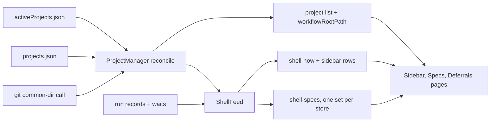

# Design Document

## Overview

The dashboard folds run worktrees into their parent, prunes registrations with missing paths at start, keeps eval servers out of the registry, reads each spec store once, and gives each sidebar row a status dot, a live-run count and an activity sort. The changes sit in the registry, the project manager, the shell feed, the MCP server start path, the eval runner and three frontend views, reusing the registry lock, the git common-dir call, the shell feed's existing reads and the spec 22 tone tokens.

## Steering Document Alignment

### Technical Standards (tech.md)
No `tech.md` exists; per the agent rules, server tests sit in `__tests__/` beside the module under vitest, and frontend behaviour is proved by the worktree Playwright suite.

### Project Structure (structure.md)
No `structure.md` exists; new server modules sit beside the code they serve, and the one new frontend module goes in `src/dashboard_frontend/src/modules/projects/`.

### Design System (design-system.md) — if applicable
No `design-system.md` exists. The dot's colours are spec 22 tone tokens (`src/dashboard_frontend/src/modules/theme/tokens.css:86-97` light, `src/dashboard_frontend/src/modules/theme/tokens.css:135-146` dark), and the dot has a text alternative (R5 AC7).

## Architecture

One serialized reconcile in the project manager builds the listed set from the registry and `projects.json`, computes folds with a pure function, and adds or removes contexts to match. Dashboard start prunes missing paths from both files, each under its file lock, before the first reconcile. The shell feed builds spec rows once per store and adds a `sidebar` array to `shell-now`; the frontend renders it and keys counts and page lists on the store identity the project list now carries.



## Components and Interfaces

### C1 — Worktree classification (`src/core/git-utils.ts`)
- **Purpose:** Classify one workspace as a linked worktree and return its main working tree, from one git call (R1 Terms, NFR Performance).
- **Interfaces:** `linkedWorktreeInfo(workspacePath: string): { linked: boolean; mainTree: string | null }`. Post-conditions: runs `git rev-parse --git-common-dir` exactly once through `gitCapture` (`src/core/git-utils.ts:64-71`, scrubbed env, 5000 ms timeout at `src/core/git-utils.ts:7-11`); `linked` is true only when the raw output is non-null and not `.git` (the test `isGitWorktree` applies at `src/core/git-utils.ts:260-270`); `mainTree` is the parent of the realpath-normalized common directory (as `gitCommonDirAbsolute` computes it at `src/core/git-utils.ts:133-139`) when that directory's base name is `.git`, else null; a failed call returns `{ linked: false, mainTree: null }`. It never reads `SPEC_WORKFLOW_SHARED_ROOT`, unlike `resolveGitRoot` (`src/core/git-utils.ts:214-252`). Never throws.
- **Dependencies:** `gitCapture` (`src/core/git-utils.ts:64-71`), `normalizeIdentityPath` (`src/core/git-utils.ts:101-112`).
- **Reuses:** its two dependencies only; it issues the common-dir command once and applies the non-`.git` test and parent-of-`.git` logic inline, not by calling `isGitWorktree` or `gitCommonDirAbsolute` (each would issue its own call).

### C2 — Fold computation (new `src/dashboard/project-folding.ts`)
- **Purpose:** Decide which candidate entries fold and into which parent (R1 AC1 to AC3, D5, D6 of requirements).
- **Interfaces:** `computeFolds(candidates: FoldCandidate[], classify: (workspacePath: string) => { linked: boolean; mainTree: string | null }): Map<string, string>` returning folded id to parent id. `FoldCandidate` is `{ projectId: string; projectPath: string; workflowRootPath: string }`. Post-conditions:
  1. `classify` is called once per candidate whose two paths differ, and never for a candidate whose paths are equal.
  2. Parents are drawn only from candidates that are not linked worktrees (equal-path candidates count as not linked). A linked worktree never becomes a parent, so folds never chain.
  3. For a linked candidate: if a parent has `projectPath` equal to the candidate's `mainTree` and `workflowRootPath` equal to the candidate's, it folds there (R1 AC1); else if a parent has `projectPath` and `workflowRootPath` both equal to the candidate's `workflowRootPath`, it folds there (R1 AC2); else it is absent from the map (R1 AC3).
  4. If `classify` throws for a candidate, that candidate does not fold and the error is reported through an optional trailing `onError?: (projectId: string, error: unknown) => void`.
- **Dependencies:** none (pure).
- **Reuses:** nothing; path comparison is plain string equality on the realpath-normalized strings the registry stores (`src/core/project-registry.ts:354-393`).

### C3 — Project manager reconcile (`src/dashboard/project-manager.ts`)
- **Purpose:** Keep the in-memory project set equal to the unfolded candidates on every change (R1 AC4, AC5, AC6; R2 AC8).
- **Interfaces:**
  - `syncWithRegistry()` keeps its name (a test calls it, `src/dashboard/__tests__/project-manager-durable.test.ts:84`) and becomes the one reconcile. Post-conditions: candidates are the registry entries plus each `projects.json` entry the registry lacks (with `instances: []`), each file read once; `computeFolds` runs with `linkedWorktreeInfo`; every unfolded candidate has a context (added by `addProject` or updated in place as `src/dashboard/project-manager.ts:146-154` does); every folded candidate and non-candidate has none (`removeProject` stops its watchers); one `projects-update` is emitted.
  - Calls to `syncWithRegistry` are serialized: a call waits for the running one, then makes its own full pass, so a watcher event and a manual add cannot add one id twice. The registry watcher's `change`/`add` handlers (`src/dashboard/project-manager.ts:115-121`) coalesce through a 100 ms trailing debounce (D12), so a run-startup burst of registry writes runs one reconcile, not one per write; `initialize()` runs the first `syncWithRegistry()` directly, not through the debounce, so the cleanup -> prune -> sync -> watcher order holds.
  - `initialize()` order: registry cleanup with the existence check (C4), `projects.json` prune (C5), `syncWithRegistry()`, then the registry watcher. `loadProjectsFromRegistry` and `loadRememberedProjects` are replaced by the first `syncWithRegistry()`.
  - `addProjectByPath` keeps its registry and `rememberProject` writes and its explicit-root re-add (`src/dashboard/project-manager.ts:364-372`), then awaits `syncWithRegistry()`; it returns the entry's id, folded or not.
  - `removeProjectById` forgets the `projects.json` entry before it unregisters (today's order is the reverse, `src/dashboard/project-manager.ts:389-393`), then awaits `syncWithRegistry()`, so a worktree it had folded is listed again (R1 AC5). Forgetting first means a `forgetProject` lock-miss throw (C5) happens before anything is removed, leaving both files whole (Error Handling #3).
  - `getProjectsList()` adds `workflowRootPath: string` (the original, untranslated workflow root) to each item (R2 AC8). No other field changes.
  - A failed classification logs once per project id per process: `[ProjectManager] Could not classify <id> (<path>): <message>; listing it`.
- **Dependencies:** C1, C2, C4, C5.
- **Reuses:** `addProject` (`src/dashboard/project-manager.ts:181-256`) unchanged, including its remember-only-equal-paths rule (`src/dashboard/project-manager.ts:240-249`), so a folded entry is never added and never remembered (R1 AC10). Per-project routes call `getProject`, which returns `undefined` for a folded id, so they answer 404 as today (`src/dashboard/multi-server.ts:576-583`, R1 AC6) with no route change.

### C4 — Registry startup cleanup (`src/core/project-registry.ts`)
- **Purpose:** Remove registry entries whose workspace or workflow root path is gone, under the registry lock (R4 AC1, AC3 to AC7).
- **Interfaces:** `cleanupStaleProjects(isMissing?: (path: string) => Promise<boolean>): Promise<number>` — the predicate is an optional trailing parameter, so existing callers and tests keep compiling. Post-conditions: the whole read-modify-write runs inside `withRegistryLock(this.lockPath, …)` (`src/core/registry-lock.ts:371-412`); with `isMissing` given, an entry is deleted when `isMissing(projectPath)` or `isMissing(workflowRootPath)` resolves true, whatever its pids; otherwise the dead-pid rule of `src/core/project-registry.ts:479-496` applies unchanged; each path deletion logs one line `[ProjectRegistry] Removed <id> from <registry path>: <missing path> does not exist`; the return value still counts removed instances. If the lock is not acquired, it logs one line and returns 0 with no write, so every entry is kept.
- **Dependencies:** the registry lock.
- **Reuses:** `readRegistry` (unchanged, still no filesystem call per entry, R4 AC5) and `writeRegistry`.

### C5 — `projects.json` lock and startup prune (`src/controller/state.ts`)
- **Purpose:** Remove remembered projects whose paths are gone, serialized with `rememberProject` and `forgetProject` (R4 AC2, AC8).
- **Interfaces:**
  - A private `withProjectsLock(fn)` takes `withRegistryLock` on `projects.json.lock` beside `projects.json` (`src/controller/state.ts:302-304`) and throws when the lock is not acquired, the same contract as `withStoreLock` (`src/controller/state.ts:559-570`).
  - `rememberProject` and `forgetProject` run their read-modify-write inside it. Signatures unchanged.
  - New `pruneMissingProjects(isMissing: (path: string) => Promise<boolean>): Promise<KnownProject[]>` runs inside the same lock, drops every entry whose `workspacePath` or `workflowRootPath` is missing, writes once when anything was dropped, logs one line per drop `[projects] Removed <id> from <projects.json path>: <missing path> does not exist`, and returns the dropped entries. On lock failure it logs and returns `[]` with no write.
- **Dependencies:** the registry lock primitive.
- **Reuses:** `readProjects`, `writeProjects` (`src/controller/state.ts:451-457`), `writeJsonAtomic` (`src/controller/state.ts:318-323`).

### C6 — Missing-path check (new `src/dashboard/path-missing.ts`)
- **Purpose:** One "does not exist" rule for C4 and C5 (R4 AC3, AC4).
- **Interfaces:** `isPathMissing(hostPath: string): Promise<boolean>`. Post-conditions: translates the path with `PathUtils.translatePath` (`src/core/path-utils.ts:108`; a no-op when Docker translation is off); a throw from translation returns false; stats the result; returns true only when the stat error code is `ENOENT` or `ENOTDIR`; any other error returns false and logs once per path.
- **Dependencies:** `PathUtils` (import only; `path-utils.ts` is a sensitive path and is not edited).

### C7 — Eval server opt-out (`src/index.ts`, `src/server.ts`, `src/evals/runner.ts`)
- **Purpose:** The server an eval step launches writes nothing to the operator's registry, and so nothing reaches `projects.json` (R3 AC1 to AC3, AC5).
- **Interfaces:**
  - `CLI_FLAGS` (`src/index.ts:164-177`) gains `'--no-register': 'boolean'`; `parseArguments` returns `noRegister: boolean`; the help OPTIONS block (`src/index.ts:37-65`) gains one entry for it ("Do not add this server to the project registry; used by eval runs").
  - `SpecWorkflowMCPServer.initialize(projectPath, workspacePath, lang?, inferredWorkspaceFallback?, options?: { register?: boolean })` — `options` is an optional trailing parameter, default `register: true`. With `register: false` it skips the registration block (`src/server.ts:185-195`), logs `Project registration skipped (--no-register)`, and leaves `registeredProjectId` unset, so `stop()` unregisters nothing (`src/server.ts:289`). Workspace, workflow root and the tool context are unchanged (R1 AC8, R3 AC3).
  - `src/index.ts:662-668` passes `{ register: !noRegister }`.
  - `runCases` (`src/evals/runner.ts:190-197`) appends `'--no-register'` to the inline server's `args`, after the fixture root. The runner reads, edits and deletes nothing in the registry or `projects.json` (R3 AC5).
- **Dependencies:** none new.
- **Reuses:** the flag registry, which derives the boolean set, the value rejection and the path filter from one map (`src/index.ts:148-163`).

### C8 — Store grouping (new `src/dashboard/shell/store-groups.ts`; `src/dashboard/shell/shell-feed.ts`)
- **Purpose:** Read each store once per flush (R2 AC7).
- **Interfaces:** `groupByStore(projects: ProjectContext[]): { workflowRootPath: string; representative: ProjectContext; projects: ProjectContext[] }[]`. Post-conditions: one group per distinct `workflowRootPath` string; the representative is the project whose `originalProjectPath` equals `workflowRootPath`, else the first by `projectName` (locale compare), then `projectId`. In `flush`, `buildSpecRows` (`src/dashboard/shell/spec-rows.ts:78-99`) runs once per group with the representative and a live spec taken from the first project in the group with a live run (`src/dashboard/shell/live-runs.ts:10-18`). Spec rows therefore carry the representative's `projectId` and `projectName`. A group whose rows throw is skipped and logged as today (`src/dashboard/shell/shell-feed.ts:98-100`).
- **Dependencies:** none new.
- **Reuses:** `buildSpecRows`, `FileCache`.

### C9 — Sidebar rows (new `src/dashboard/shell/sidebar-rows.ts`; `shell-feed.ts`; `src/dashboard/shell/types.ts`)
- **Purpose:** Compute each listed project's dot, live-run count, last activity and sort position on the server, from data the feed already reads (R5 AC1 to AC6, AC9, AC11; R6).
- **Interfaces:**
  - `NOW_LIVE_STATUSES: readonly string[]` = `['queued', 'running', 'merging', 'paused', 'waiting']`, the server copy of `CTRL_LIVE_STATUSES` (`src/dashboard_frontend/src/modules/shell/NowPage.tsx:27`).
  - `buildSidebarRows(projects: { projectId: string; projectName: string }[], now: NowModel, waits: ControllerWait[], runs: ControllerRun[]): SidebarProjectRow[]`. Post-conditions, per project id P:
    - `liveCount` = the number of `runs` with `project` P and a status in `NOW_LIVE_STATUSES`; when that is 0, the number of `now.live` rows with `projectId` P (the Now page's rule at `src/dashboard_frontend/src/modules/shell/NowPage.tsx:257-264`, R5 AC5).
    - `dot` = `waiting` when some `waits` entry has `project` P and `state` `open`, or some `now.waits` row has `projectId` P (R5 AC2, D7 of requirements); else `running` when `liveCount` is 1 or more (R5 AC3); else `idle` (R5 AC4).
    - `lastActivity` = the greatest `updated` among `runs` with `project` P, any status, else null (R6 AC3).
    - Order: `waiting` and `running` rows before `idle` rows (R6 AC1); within each group, non-null `lastActivity` newest first, then null (R6 AC2, AC4); ties by `projectName` (locale compare), then `projectId`. The order is a total order over the inputs, so equal inputs give an equal order (R6 AC5).
    - The sidebar filter is not an input (R5 AC11).
  - `NowModel` (`src/dashboard/shell/types.ts`) gains `sidebar: SidebarProjectRow[]`; `buildNowModel` returns `[]`; `flush` fills it after it reads waits and runs, before it sends `shell-now`. `SidebarProjectRow` is `{ projectId: string; dot: 'waiting' | 'running' | 'idle'; liveCount: number; lastActivity: string | null }`.
- **Dependencies:** the waits and runs `flush` already reads (`src/dashboard/shell/shell-feed.ts:103-115`).
- **Reuses:** the existing `shell-now` topic; no new route, poll or topic (R5 AC9).

### C10 — Frontend store identity (`ProjectProvider.tsx`; new `src/dashboard_frontend/src/modules/projects/stores.ts`)
- **Purpose:** Give the counts, the filter and both page lists one store key (R2 AC1 to AC6, AC8).
- **Interfaces:**
  - `Project` (`src/dashboard_frontend/src/modules/projects/ProjectProvider.tsx:8-13`) gains `workflowRootPath: string`.
  - `storeGroups(projects: Project[], enabled: (id: string) => boolean): { store: string; representative: Project; projects: Project[]; enabled: boolean }[]` — one group per `workflowRootPath`; representative rule as in C8, using `projectPath` for the workspace; `enabled` is true when any project in the group is enabled (R2 AC3, D10 of requirements).
  - `storeOf(projects: Project[], projectId: string): string` — the project's `workflowRootPath`, else the id itself, so a row whose project the 2.5 s poll has not delivered yet keeps today's behaviour.
- **Dependencies:** none.

### C11 — Sidebar (`src/dashboard_frontend/src/modules/shell/Sidebar.tsx`)
- **Purpose:** Correct counts, the dot, the count and the order (R2 AC1 to AC4, R5, R6).
- **Interfaces:**
  - Specs count: `specRows` whose store (`storeOf` on `row.projectId`) is in an enabled group; rows are one per store and spec (C8), so each pair counts once (R2 AC1).
  - Deferrals count: per enabled group, the `deferred` records of the first project in the group with a payload in `deferralsByProject` (R2 AC2); payloads are built per store (`src/dashboard/multi-server.ts:464-473`).
  - Project rows: sorted by the index of `projectId` in `now.sidebar`; a project absent from it goes after all present ones, by `projectName`. Each row renders, after the toggle and before the name, one dot (`span`, 8 px circle, `role="img"`, `aria-label` and `title` such as "Running, 1 live run", "Waiting on you", "Idle") and, when `liveCount` is 1 or more, the count as text in the row's existing muted text style (R5 AC1, AC6, AC7). A project absent from `now.sidebar` shows `idle` with no count.
  - Dot colours: `waiting` uses `--tone-warning-fg`, `running` uses `--tone-success-fg`, `idle` uses `--tone-neutral-fg` (R5 AC8). No other element, size or spacing changes (R5 AC10). Test ids added: `project-dot-<projectId>` with a `data-state` attribute, `project-live-count-<projectId>`.
- **Dependencies:** C9 rows in `now`, C10.

### C12 — Specs and Deferrals pages (`SpecsPage.tsx`, `DeferralsPage.tsx`, frontend `types.ts`)
- **Purpose:** List each store's rows once, grouped by store, so a page's count equals the sidebar count under the same filter (R2 AC5, AC6).
- **Interfaces:**
  - Both pages iterate `storeGroups(projects, enabled)` filtered to enabled groups, in place of `enabledProjects` (`src/dashboard_frontend/src/modules/shell/SpecsPage.tsx:82-144`, `src/dashboard_frontend/src/modules/shell/DeferralsPage.tsx:88-165`). Group key and selection key use the store (`<store>::<spec>`, `<store>::<deferral id>`); the group title is the representative's `projectName`.
  - Specs: a group's rows are the `specRows` whose store is the group's store. Deferrals: a group's records come from the first project in the group with a payload.
  - Row test ids keep their form: `spec-row-<row.projectId>-<spec>` and `deferral-row-<representative id>-<deferral id>`. In the one-store-per-project e2e fixtures (`e2e/worktree-shell.spec.ts:108`) these ids do not change.
  - The frontend `NowModel` hand copy (`src/dashboard_frontend/src/modules/shell/types.ts:86-93`) gains `sidebar`, and `SidebarProjectRow` is copied by hand beside it.
- **Dependencies:** C10.

## Data Models

### Project-list item (`GET /api/projects/list`)
```
{ projectId: string; projectName: string; projectPath: string;
  workflowRootPath: string;   // new: original workflow root, the store key
  instances: ProjectInstance[] }
```

### SidebarProjectRow (in `shell-now` data as `sidebar`)
```
{ projectId: string;
  dot: 'waiting' | 'running' | 'idle';
  liveCount: number;           // 0 or more
  lastActivity: string | null  // ISO, newest run record `updated`
}
```
The array is in sidebar order. It adds no path to the wire (NFR Security).

### Lock file
`projects.json.lock` in the controller home, created and released by `withRegistryLock`; no content contract.

## Error Handling

1. **Git classification fails or times out:** `linkedWorktreeInfo` returns not-linked, so the entry stays listed (NFR Reliability). A throw inside `computeFolds` keeps the entry and logs once per id.
2. **Registry lock not acquired at start:** the cleanup logs one line and keeps every entry; the dashboard still starts and lists them.
3. **`projects.json` lock not acquired:** the prune logs and keeps every entry. `rememberProject` throws, which `addProject` already catches and logs (`src/dashboard/project-manager.ts:246-248`), making the explicit-root manual add answer 500 as a failed write does today. `forgetProject` throws too; `removeProjectById` calls it before it unregisters (C3), so the throw happens before the registry and `projects.json` are touched: the DELETE answers 500 with both files whole and a retry removes the entry cleanly, never a registry-removed but still-remembered entry the next sync re-lists.
4. **Stat fails with anything other than `ENOENT` or `ENOTDIR`** (permission, I/O): the entry is kept and the path is logged once (R4 AC3, D11 of requirements).
5. **Docker path translation throws:** the entry is kept (R4 AC4).
6. **A live server's workspace was deleted:** the prune removes its entry whatever its pid (R4 AC1); its later `stop()` finds no entry (`src/core/project-registry.ts:421-425`).
7. **`--no-register=true`:** rejected by the existing boolean-flag rule (`src/index.ts:240-245`).

## Testing Strategy

- **Unit:**
  - `src/core/__tests__/git-utils-worktree.test.ts` (new): `linkedWorktreeInfo` on a main checkout (not linked), a `git worktree add` (linked, main tree the checkout's realpath), a non-git directory, and with `SPEC_WORKFLOW_SHARED_ROOT` set (main tree still the checkout).
  - `src/dashboard/__tests__/project-folding.test.ts` (new): `computeFolds` with a stub `classify` — R1 AC1 fold, AC2 fallback, AC2 refused on another store, AC3 no parent, AC9 not folded, no linked parent, no `classify` call for equal paths, a throw keeps the entry.
  - `src/dashboard/__tests__/project-manager-durable.test.ts`: new cases for fold on sync, unfold when the parent is removed, fold when the parent is added later (R1 AC5), `workflowRootPath` on `getProjectsList`, a startup prune of both files, concurrent `syncWithRegistry` calls leaving one context per id, a write burst running one debounced reconcile with the first reconcile direct (R1-2), and a `removeProjectById` whose `forgetProject` lock-miss removes nothing and rethrows (R1-3). Changed values at `src/dashboard/__tests__/project-manager-durable.test.ts:87` (expects 1, not 2 — the worktree folds into its main project) and `src/dashboard/__tests__/project-manager-durable.test.ts:115` (expects `[]`, not the id — the deleted project is pruned at start), both required by R1 AC1 and R4 AC2.
  - `src/core/__tests__/project-registry.test.ts`: `cleanupStaleProjects(isMissing)` removes a missing-path entry with a live pid, keeps one the predicate passes, writes nothing when the lock is held, and logs. Existing values are unchanged.
  - `src/controller/__tests__/state.test.ts`: `pruneMissingProjects` drops and returns missing entries; a `rememberProject` during the prune is not lost (R4 AC8).
  - `src/dashboard/__tests__/path-missing.test.ts` (new): `ENOENT` and `ENOTDIR` are missing; an existing path is not; a translation throw is not.
  - `src/__tests__/index-args.test.ts`: `--no-register` parses to `noRegister: true` and `--no-register=1` is rejected.
  - `src/__tests__/server-shutdown.test.ts`: `initialize(…, { register: false })` writes no registry entry and `stop()` writes nothing.
  - `src/evals/__tests__/runner.test.ts`: the stub step receives a server entry whose `args` include `--no-register` (R3 AC4).
  - `src/dashboard/shell/__tests__/store-groups.test.ts` and `sidebar-rows.test.ts` (new): representative rule; each dot rule; live count with and without a controller run; last activity across statuses; sort order, ties and stability. `sidebar-rows.test.ts` also reads `NowPage.tsx` as text and asserts its `CTRL_LIVE_STATUSES` literal equals `NOW_LIVE_STATUSES`.
  - `src/dashboard/shell/__tests__/shell-feed.test.ts`: two projects on one store give one set of spec rows; `shell-now` carries `sidebar`. Message order is unchanged; an assertion that deep-equals a `shell-now` payload gains the `sidebar` key.
- **Integration:** `src/evals/__tests__/runner-registry.test.ts` (new) runs `runCases` with a stub step that starts the configured server for real: it takes the `args` from the step's MCP config, swaps `dist/index.js` for `src/index.ts` and runs it with `tsx` (a dev dependency, used by `npm run dev`), waits for whichever startup line the run prints — `Project registered:` at base (`src/server.ts:195`) or `Project registration skipped` after the fix (C7), a signal present in both states — then ends the child's stdin and waits for exit code 0 (`src/server.ts:234`), and asserts the per-worker registry and `projects.json` are byte-equal to before (R3 AC1, AC2, R7 AC2). It asserts only node-20-guaranteed fields: a stderr `data` line and the child's `exit` code; ending stdin fires the child's `'end'` and it exits 0. At base the args lack the flag, the server registers the fixture, and the test fails.
- **End-to-end:** `e2e/worktree-project-list.spec.ts` (new, worktree Playwright config, `./playwright.worktree.config.ts:46-70`). It adds a main repo, starts one worktree MCP server on the same store, and seeds a controller run record (status `running`, project the main id) as `e2e/worktree-shell.spec.ts:174` does: one sidebar row, `data-state="running"`, count 1, and Specs and Deferrals counts equal to those read before the worktree server started (R7 AC1). A second project with a seeded open wait and an older run sorts above an idle project with a newer done run, with `data-state="waiting"` (R7 AC4). It also toggles the main project off and checks the dot and position stay (R5 AC11). R7 AC3 (deleted workspace, restart) is the `project-manager-durable` start-time case above, since the Playwright dashboard cannot restart mid-suite. `npm run build`, `npx tsc --noEmit` and `npm test` close the gate (R7 AC5).
- **Regression guards (hold at base, verified, not red-first):** R1 AC3 (`e2e/worktree-shared.spec.ts:370-414` stays green), R1 AC7 (`e2e/worktree-shared.spec.ts:748-795`), R1 AC8, R1 AC9, R1 AC10, R4 AC5 (`readRegistry` is not edited), R5 AC8 (the existing frontend style scan, `src/dashboard/__tests__/frontend-style-scan.test.ts`), R5 AC10.
- **Why no frontend vitest test:** a 2026-10-29 probe showed vitest 4.0.16 imports a frontend module from a root test, but `tsc` 5.9.3 under the root `node16` resolution (`./tsconfig.json:4-5`) rejects its extensionless imports (TS2835 on `src/dashboard_frontend/src/modules/shell/pause.ts:1`). So C9 lives on the server and C10 to C12 are proved by Playwright.

## Decisions taken in this document

- D1 — Dot, count and sort computed on the server in the shell feed (over the frontend from controller topics), because root tests cannot type-check a frontend module (probe in Testing Strategy) and the feed already reads every input.
- D2 — Eval server stays out of the registry via a no-register CLI flag (over pointing the global-directory variable at a fixture, or an inline-config env field), because both ends are in this repository and the others need Claude Code to pass env to its MCP child, unprovable without a live model.
- D3 — Folds stay current through one full serialized reconcile per sync, manual add and removal (over incremental add/remove per event), because a parent's arrival or removal changes other entries' folds and two concurrent passes could add one id twice.
- D4 — Only non-worktree entries can be parents (over any listed entry), so folds never chain or depend on order.
- D5 — The store's representative is the project whose workspace is the store, else by display name then id (over registry order), so the Specs title and spec-row project id are stable across restarts.
- D6 — The durable-list prune serializes with remember and forget via a file lock on its own lock path (over an in-process queue), because the per-store lock already uses this primitive and it also covers a second dashboard process.
- D7 — Registry stats run inside the registry lock (over before it with a re-check under it), because it runs once per start over a few entries.
- D8 — The path check joins the registry cleanup as an optional predicate run under the lock (over a second prune method with its own write), so start does one locked read and one write.
- D9 — Dot colours: warning for waiting, success for running, neutral for idle (over the danger or info tones), because waiting is the call to action.
- D10 — Last-sort tie-break is project id after display name (over list order), so a push that changes nothing cannot reorder rows.
- D11 — The server's live-status set is a copy of the Now page's set plus a test that compares the two by reading the page source (over a shared module, which the separate frontend compile does not allow).
- D12 — Classification cost and volume: no per-path cache (one git call per differing entry per sync, as the requirements' performance note states), plus a 100 ms trailing debounce on the watcher so a write burst runs one reconcile, not one per write. The synchronous `gitCapture` blocks the reconcile up to its 5000 ms timeout per differing candidate; the debounce bounds a burst to one such pass.
- D13 — Dot position after the toggle and before the name, count after the dot (over after the name), so the name keeps its truncation.

## Scope notes

- Kept: items 1 to 6 and every file the decomposition names — the registry (cleanup in C4), the project manager (C3), `projects.json` (C5), the eval path (C7; `src/evals/fixture.ts` is unchanged, the registration comes from the server the runner starts), the sidebar (C11) and the Specs and Deferrals counts (C8, C11, C12).
- Cut, as the requirements record: one row per product, better display names, a persistent Hide, nested worktrees, a Remove action.
- Deferred, as the requirements record: pruning while the dashboard runs; showing a folded worktree's server instances on its parent row.
- Not changed: the Now page's own rows for two projects sharing a store (only the dot must agree with them); a project whose workflow root moves during a sync keeps its old watchers (`src/dashboard/project-manager.ts:146-154`), existing behaviour outside this spec.
- Carried items from requirements: none.

## Revision History

- **v2** (2026-10-29) — Round-1 adversarial response (adversarial-analysis-design.md, verdict iterate 0/3/2).
  - **R1-1 — Accepted (SHOULD_FIX).** Integration test now waits for whichever startup line prints (registered at base, skip after the fix — a signal in both states), ends stdin and waits for exit 0, and names the node-20 fields it asserts on. Testing Strategy Integration now reads "waits for whichever startup line the run prints".
  - **R1-2 — Accepted (SHOULD_FIX).** Watcher reconcile now coalesces writes through a 100 ms trailing debounce, first reconcile still called directly to keep the initialize order; D12 states the synchronous call is bounded at 5000 ms per differing candidate and coalesced to one pass per burst. C3 serialized bullet and D12 changed.
  - **R1-3 — Accepted (SHOULD_FIX).** removeProjectById now forgets before it unregisters, so a lock-miss throw leaves both files whole and the DELETE answers 500 for a clean retry, never a registry-removed but still-remembered entry. C3 removeProjectById bullet and Error Handling item 3 changed.
  - **R1-4 — Accepted (MINOR).** C1 Reuses now says it issues the common-dir command once and applies the worktree test and parent logic inline, not by calling the two helpers that each issue their own call.
  - **R1-5 — Accepted (MINOR).** Dropped the "illustrative — verify against the test fake" hedge from both Data Models shapes; the enumerated fields are the pinned contract.
- **v1** (2026-10-29) — Initial draft.
  - **Lint pass.** 5 fixed: L-3,15,16 gave each listed existing function its own range; L-38,41 prefixed the root config files with `./`. Rejected: L-1,2,4,5,10,11,13,14,20,25,26,27,30,31,35,36 (identifier this design defines, not a cited-code claim); L-6,7,8,9,19,21,22,23,24,28,29,32,33,34 (citation anchors the behaviour it names, not the reused subject's declaration); L-12,17,18,37,39,40 (keyword/literal/tool name, not a citable symbol).
