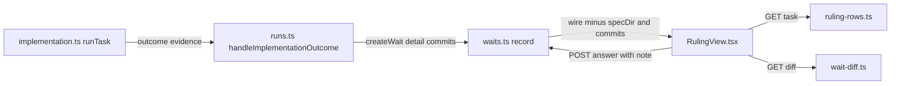

# Design Document

## Overview

The ruling view replaces the answer sheet with one full-width screen per wait, rendered by a new `RulingView.tsx` and fed by two new read-only wait routes (task row, diff). The implementation phase puts the stopping worker's report, the latest task review and the task's commits on its outcome, and the run driver writes them into the wait as `detail` and `commits`. It reuses the wait store, `stage.ts`, the task parser, `TaskReviewManager`, and the answer and second-opinion routes.

## Steering Document Alignment

### Technical Standards (tech.md)
This spec store has no steering files (`.spec-workflow/steering/` is empty). The design follows `agent-rules.md`: tests go in `__tests__/` next to the code, git gets an argument array and `scrubbedGitEnv()` (`src/core/git-utils.ts:45-51`), and no absolute path reaches the browser.

### Project Structure (structure.md)
New server builders go in `src/dashboard/shell/`, the pure detail builder in `src/controller/`, and the view in `src/dashboard_frontend/src/modules/shell/`.

### Design System (design-system.md) — if applicable
N/A: there is no `design-system.md`. The view uses only token classes the shell already uses (`ui.panel`, `text-display`, `--text-*`, `--tone-*`), so `src/dashboard/__tests__/frontend-style-scan.test.ts` stays green.

## Architecture

The change adds three seams. (1) `runTask` wraps its steps, and on a `design-defect`, `escalate` or `error` outcome it attaches `task`, `commits` and `detail` in one place. (2) Two GET routes read the server-side wait record (which still holds `specDir`, `commits` and the run id) and return path-free JSON. (3) Home keeps the opened wait on screen while its answer stage is in flight; the stage resolves when the run leaves `waiting`. The answer route also takes an optional `note` field that goes to the receipt and the ledger row, not to the answer value.



## Components and Interfaces

### C1 — Wait record fields
- **Purpose:** Store the evidence in the wait (R2 AC 1, AC 12).
- **Interfaces:** `WaitRecord` (`src/controller/state.ts:207-226`) and `CreateWaitInput` (`src/controller/waits.ts:52-62`) gain `detail?: string` and `commits?: string[]`. `createWait` (`src/controller/waits.ts:98-118`) copies each onto the record only when present (for `commits`, non-empty). `listWaitsForWire` (`src/controller/waits.ts:241-243`) strips `commits` as well as `specDir`; its return type becomes `Omit<ControllerWaitRecord, 'specDir' | 'commits'>[]`.
- **Reuses:** the `proposals` pattern at `src/controller/waits.ts:114`. Both wire paths use `listWaitsForWire`: the GET route (`src/dashboard/multi-server.ts:697-699`) and the shell feed (`src/dashboard/shell/shell-feed.ts:107`).

### C2 — Ruling evidence in the implementation phase
- **Purpose:** Put `task`, `commits` and `detail` on every stop made while a task is picked (R2 AC 2-8).
- **Interfaces:**
  - `ImplementationPhaseOutcome` (`src/controller/phases/implementation.ts:124-144`) gains `detail?: string` and `commits?: string[]`.
  - New pure module `src/controller/ruling-detail.ts`:
    - `DETAIL_REPORT_CAP = 12_000`, `DETAIL_REVIEW_CAP = 8_000`.
    - `capPart(text: string, cap: number): string` returns `text` unchanged when `text.length` is at most `cap`; otherwise `text.slice(0, cap)`, a newline and `[N characters dropped]` with N = `text.length - cap`.
    - `renderReview(review: TaskReview): string`: line `v<version> — <verdict>`, the summary, then per finding in stored order `- [<severity>] <title>`, plus ` (<file>:<line>)` or ` (<file>)` when `file` is present, and the description on the next line.
    - `buildRulingDetail(report: string | undefined, review: TaskReview | null): string | undefined` returns `undefined` when both are absent. Otherwise it holds `## Worker report`, a blank line and the capped report when a report exists, then `## Task review`, a blank line and the capped `renderReview` when a review exists, with a blank line between parts.
    - `rulingCommits(red: string | undefined, later: string[]): string[]` returns `[red, ...later]`, `red` left out when undefined, duplicates removed keeping the first, order otherwise unchanged.
  - The current `runTask` body (`src/controller/phases/implementation.ts:649-952`) becomes `runTaskSteps(task, ev)`, with `ev` a local `{ report?: string; commits?: () => string[] }`. The new `runTask(task)` calls it. For a `design-defect`, `escalate` or `error` outcome it returns the outcome plus `task: outcome.task ?? task.id`, `commits: ev.commits?.() ?? []` and `detail: buildRulingDetail(ev.report, latest)`, where `latest` is `getLatestReview(task.id)` on `new TaskReviewManager(ctx.specDir)` (`src/core/task-review-manager.ts:182-185`), and a throw reads as `null`. Any other outcome passes unchanged.
  - Right after `taskCommits` (`src/controller/phases/implementation.ts:668-669`): `ev.commits = () => rulingCommits(redCommit, taskCommits())`. It reads `redCommit` when called, so a red commit found later is included.
  - `ev.report` is set only where a worker report causes the stop: before the SEAM-DEFECT `return stop(…)` (`src/controller/phases/implementation.ts:703-704`) and before each `if (flagged) return flagged` (`:787-788`, `:945-947`). The value is the step's `resultText` when non-empty, else the structured report as JSON.
  - `stop` (`src/controller/phases/implementation.ts:566-578`) and `routeImplementerFlags` (`:960-1005`) do not change. An error stop still passes no `task` option, so the task is not reset to pending; the tag rides only on the outcome.
- **Dependencies:** `TaskReview` (`src/types.ts:297-308`), `ReviewFinding` (`src/types.ts:242-251`).
- **Out of reach:** an `error` from the orient step or a vanished task (`src/controller/phases/implementation.ts:622-635`) comes before a task is picked and carries no evidence. The worker report schemas (`:152-182`) do not change (R2 AC 11).

### C3 — Wait creation in the run driver
- **Purpose:** Write the evidence into the ruling and error waits (R2 AC 9, AC 10).
- **Interfaces:** `waitAnd` (`src/controller/runs.ts:622-631`) gains a trailing optional `evidence?: { detail?: string; commits?: string[] }`, passed to `createWait`. In `handleImplementationOutcome` (`src/controller/runs.ts:1242-1309`), the ruling wait (`:1259-1271`) and the final `error` wait (`:1303-1307`) pass `{ detail: outcome.detail, commits: outcome.commits }`, and the `error` question gains `task: outcome.task` when set. The security wait (`:1283-1289`), the document escalation (`:1359-1364`) and every other caller pass none: the R2 AC 10 invariant.
- **Note:** an `error` outcome first takes the one fresh retry (`src/controller/runs.ts:1296-1301`); only the outcome that opens the wait carries evidence. `escalationRulings` (`:1188-1204`) reads only `escalation` waits, so a tag on an `error` question changes no ruling.

### C4 — Answer with a note, and the ruling receipt
- **Purpose:** Carry the note, and write `questions.md` for escalation and error waits (R6 AC 5-7).
- **Interfaces:**
  - `answerWait(id, answers, by, note?: string)` (`src/controller/waits.ts:127-155`). The note is not stored on the record (the entry fixes the new record fields at two).
  - For `gate-a` and `gate-b` the receipt renders as today (`src/controller/waits.ts:260-272`) plus a last line `Notes: <note>` when sent. For escalation and error a new `rulingSection(record, note)` renders under `## <kind> <wait id>` (for example `## escalation w-1a2b3c4d`): per question `<n>. <text>`, `   Task: <task>` when tagged, `   Answer: <value or "no answer">`, then `Notes: <note>` when sent. `upsertSection` (`:295-302`) keys on that heading, so a later wait never replaces an earlier wait's section.
  - `noteText` (`src/controller/waits.ts:305-309`) appends `; note: <note>` when sent, so the ledger row ends with the note.
  - Answer route (`src/dashboard/multi-server.ts:701-715`): body `{ answers?, by?, note? }`; a string `note` non-empty after trim goes to `answerWait`. `checkAnswerKeys` (`src/advisor/actions.ts:145-154`) still sees only `answers`.

### C5 — Task row route
- **Purpose:** Serve the task row live from `tasks.md` and the ledger (R3 AC 2-5).
- **Interfaces:**
  - `GET /api/controller/waits/:id/task`: 404 `{ error: 'wait-not-found' }` for an unknown id, else a `WaitTaskRow`. The route reads the record with `readWait` (imported at `src/dashboard/multi-server.ts:45`); the task id is the first question's `task`, and no tag gives `{ state: 'no-task' }`.
  - New module `src/dashboard/shell/ruling-rows.ts`:
    - `riskFromLedger(ledgerText: string, taskId: string): 'low' | 'medium' | 'high' | null` returns the risk of the last `note` row whose `text` matches `^gate: task <taskId> \S+ risk (low|medium|high)\b` (task id regex-escaped, any run, torn lines skipped).
    - `readTaskRow(specDir: string, taskId: string): WaitTaskRow` parses `tasks.md` with `parseTasksFromMarkdown` (`src/core/task-parser.ts:194`) and `taskBlock` (`:424-444`). `success` is the `Success` entry of `promptStructured` (`:143-169`), else `null`; `tdd` is `isTddMarked(task, block)`; `files` is `task.files ?? []`; `risk` is `riskFromLedger` over `harness-events.jsonl` (`null` when missing). A missing `tasks.md` or an absent id gives `{ state: 'not-found', id }`.
  - `isTddMarked` (`src/controller/phases/implementation.ts:256-259`) gets `export`; its body does not change.
- **Reuses:** the gate note written at `src/controller/phases/implementation.ts:848`; risk values from `src/tools/review-gate.ts:73-74`.

### C6 — Diff route
- **Purpose:** Read the task's diff live from the run's worktree (R4).
- **Interfaces:**
  - `GET /api/controller/waits/:id/diff`: 404 `{ error: 'wait-not-found' }` for an unknown id, else 200 with a `WaitDiff`. It reads the record with `readWait` and the run with `readRun` (`src/controller/state.ts:414-416`), and caches nothing.
  - New module `src/dashboard/shell/wait-diff.ts`:
    - `readWaitDiff(wait: { commits?: string[] }, run: { worktree: string } | undefined, opts?: { timeoutMs?: number }): Promise<WaitDiff>`, `timeoutMs` default 10 000. In order: no `run` gives `run-gone`; no or empty `commits` gives `no-commits`; a `worktree` that `fs.stat` cannot find gives `worktree-gone`. Then per hash, oldest first: a hash failing `^[0-9a-f]{7,40}$` never reaches git and is listed not found; else `git cat-file -e <hash>^{commit}` runs, and a non-zero exit lists it not found; else `git show --no-color --no-ext-diff --format=%h%x00%s <hash> --` runs. Every call uses `execFile` with `{ cwd: worktree, env: scrubbedGitEnv(), timeout: remaining, maxBuffer: 32 MiB }`.
    - One budget covers all calls in a request. A timeout kill, a `show` failure or a buffer overflow gives `{ state: 'unreadable', error }`, where `error` is the first stderr line, `git timed out after 10 s` or `git output over 32 MiB`, with the worktree prefix replaced by `.` and any other token starting with `/` replaced by `[path]` (R4 AC 10).
    - `parseShow(text: string): { hash: string; subject: string; files: DiffFile[] }` (pure): line one splits on NUL into hash and subject; each `diff --git` header starts a file; the path is the `+++ b/` path, else the `--- a/` path, else the header's `b/` side; `Binary files … differ` sets `binary`; each `@@` line starts a hunk; `+` is `add`, `-` is `del`, space is `ctx`, `\` lines are skipped.
    - `capDiff(commits: DiffCommit[]): WaitDiff` (pure), in commit order: hunks are kept for the first 60 files with hunks or binary; each later file leaves its commit and its path goes to `overflow.paths`, with `overflow.count` the total; each kept file keeps 400 hunk lines and `droppedLines` counts the rest; while `JSON.stringify` of the result is over 512 KiB, kept files move from the end into `overflow`.
  - Probes (scripts in `/tmp/scratchpad/sdd/dashboard-ruling-view/`): on node 20.20.2 and 24.13.0, `execFile` with `timeout: 300` on `sleep 5` called back at about 310 ms with `killed: true`, and an exceeded `maxBuffer` gave `code: 'ERR_CHILD_PROCESS_STDIO_MAXBUFFER'`. On git 2.43.0, `cat-file -e` exited 128 for a missing object and 0 for a present one; `show --format=%h%x00%s` printed the short hash, NUL, the subject, a blank line and the patch; a binary file printed `Binary files /dev/null and b/b.bin differ`.

### C7 — Wire types
- **Purpose:** Keep the hand copies in step (R2 AC 12).
- **Interfaces:** in `src/dashboard/shell/types.ts:57-95` and `src/dashboard_frontend/src/modules/shell/types.ts:53-91`, `ControllerWaitQuestion` gains `task?: string` and `ControllerWait` gains `detail?: string`; neither gains `commits`. Both add `WaitTaskRow`, `WaitDiff`, `DiffCommit`, `DiffFile`, `DiffHunk`.

### C8 — Ruling view (frontend)
- **Purpose:** One screen per wait (R1, R3, R5, R6).
- **Interfaces:**
  - New pure module `src/dashboard_frontend/src/modules/shell/ruling.ts` (type-only imports, no React):
    - `rulingLayout(wait)` returns `'security'` when any question id is `security`; `'task'` for an `escalation` or `error` whose first question has `task`; `'taskless'` for any other `escalation` or `error`; `'gate'` for `gate-a` and `gate-b`; else the kind (`retro-plan`, `merge`, `question`).
    - `initialValues(wait)`: each question's `recommended`, else `''`. This replaces `defaultValue` (`src/dashboard_frontend/src/modules/shell/AnswerSheet.tsx:85-90`), which picked the first option.
    - `answerOf(q, pick, text)`: options and `free` give `text.trim()` when non-empty, else `pick`; options alone give `pick`; otherwise `text`.
    - `canSubmit(wait, picks, texts)`: false while a question with options has neither a pick nor (when `free`) non-empty text, or while a `ruling` question's text is empty after trim.
    - `answerPayload(wait, picks, texts, notes): { answers; note? }`: with non-empty notes and at least one typed-text answer, the first typed-text answer in question order gets a blank line, `Notes: ` and the notes, and `note` is absent; with only picked answers, the notes go in `note`. A `retro-plan` wait adds the `proposal:<i>` keys as today (`src/dashboard_frontend/src/modules/shell/AnswerSheet.tsx:254-257`).
    - `securityLines(text)`: first line `lead`, last line `tail`, the lines between `findings`; this matches the text written at `src/controller/runs.ts:1285-1287`.
    - `offersAbandon(wait)`: true for an `escalation` or `error` whose first question has no `abandon` option.
  - New `RulingView.tsx` in the same folder: `RulingView(props: { wait; runs: ControllerRun[]; projectName; now: number; stage: Stage | null; onAnswer: (body: { answers; by: 'operator'; note? }) => void })`. The root keeps `data-testid="now-answer-sheet"`, so the Home cases at `e2e/worktree-board.spec.ts:699-789` stay valid. Render order:
    1. Header (`ruling-header`): kind, project, spec, wait id, `Age <compactAge> ago` in `text-display tabular-nums` (`ruling-age`; the tile class at `src/dashboard_frontend/src/modules/shell/tiles.tsx:90`), run id, the run's `phase` and `stepKind` or `run record gone`, and `task <id>` when tagged.
    2. Body by layout. `task`: question texts, task row (`ruling-task-row`), detail (`ruling-detail`), diff (`ruling-diff`); both fetches run once on mount. `taskless`: texts and `no task: raised in the <phase> phase` (`unknown` when the run is gone). `security`: `lead`, a list of `findings`, `tail`. `gate`: questions, then `proposals` under `Recorded without asking` (gate-a) or `The plan` (gate-b). `retro-plan`: questions and the proposal checkboxes moved from `src/dashboard_frontend/src/modules/shell/AnswerSheet.tsx:210-260`. `merge`: from `mergeRead` (`src/dashboard_frontend/src/modules/shell/board.ts:152-163`) the PR number (a link when `url` is https), CI, mergeable, verdict and every reason, else `PR not read yet`. `question`: questions.
    3. Form: radios (`answer-opt-<qid>`) with `(recommended)` and the `reason` beside the recommended option; text boxes (`answer-text-<qid>`) where R5 AC 2 and R6 AC 1, AC 3 call for them; one notes box (`ruling-notes`). Except for `merge`: `Answer and continue the run` (`answer-submit`, disabled while `!canSubmit` or the stage is `pressed` or `running`) and `Abandon the run` (`ruling-abandon`) when `offersAbandon`. For `merge`: `Merge` (`answer-submit`) and `Hold` (`answer-hold`). Then `SecondOpinionButton` with the opinion or advice (moved from `src/dashboard_frontend/src/modules/shell/AnswerSheet.tsx:45-78`, `:307-317`) and the stage line (`answer-stage`: `pressed`, `running`, `done` or `failed: <reason>`).
  - Task row: id, title, `Success` (or `no Success clause`), `TDD yes` or `TDD no`, risk (or `risk not scored yet`), each file; `not-found` shows `task <id> not found in tasks.md`. Detail: `detail` in a `whitespace-pre-wrap` block, or `no worker report or task review`.
  - Diff by state. `ok`: per commit `<hash> <subject>`; per file the path, each hunk header and its lines (add on `--tone-success-*`, del on `--tone-danger-*`, ctx on `--text-secondary`), `<n> lines dropped` for a cut file, `binary`, `not found in the worktree` for a missing commit, then the overflow paths and count. `worktree-gone`: `worktree gone`. `no-commits`: `no commits for this task`. `run-gone`: `run record gone`. `unreadable`: `git could not read the diff: <error>`. A fetch failure: `diff request failed (<status>)`.
  - `AnswerSheet.tsx` is deleted; its only importer (`src/dashboard_frontend/src/modules/shell/HomePage.tsx:6`) switches to `RulingView`.

### C9 — Answer stage and the retained view
- **Purpose:** Show the button's stage in place; keep the view on the answered wait until done or failed (R6 AC 11, AC 12; R1 AC 5, AC 7).
- **Interfaces:**
  - `StageName` (`src/dashboard_frontend/src/modules/shell/stage.ts:13`) gains `'answer'`; `resolved` (`:73-96`) gains `case 'answer': return seen.run === undefined || seen.run.status !== 'waiting';`. `responseStage` and `advance` (`:55-70`, `:106-123`) do not change, so a non-2xx gives `failed` with the body's `reason`, else `error`.
  - In `HomePage` (`src/dashboard_frontend/src/modules/shell/HomePage.tsx:148-171`): the stage key is `wait:<id>`; `onAnswer` calls `stages.press(key, 'answer', '/api/controller/waits/<id>/answer', 'POST', body)`. A ref keeps the last live snapshot of the open wait. `openWait` is the live wait from `needsYouWaits`, else the snapshot only while `stages.stages` holds the key, else `null` (the board returns, R1 AC 7). The view gets `stages.retained(key, { run })`, `run` from `controllerRuns`. An effect clears `openWaitId` when that stage is `done`. `Back to board` clears the key's stage too. The existing one-second `tick` (`:60-63`) is passed as `now`.
- **Reuses:** `useStages` (`src/dashboard_frontend/src/modules/shell/useStages.ts:24-49`), `callHarness` (`src/dashboard_frontend/src/modules/shell/harness.tsx:11-24`).

## Data Models

Illustrative — verify against the test fakes.

```ts
// WaitRecord additions (src/controller/state.ts)
detail?: string;      // "## Worker report" then "## Task review", each capped
commits?: string[];   // full hashes, red commit first, oldest first

// src/dashboard/shell/types.ts and the frontend copy
type WaitTaskRow =
  | { state: 'ok'; id: string; title: string; success: string | null; tdd: boolean;
      risk: 'low' | 'medium' | 'high' | null; files: string[] }
  | { state: 'not-found'; id: string }
  | { state: 'no-task' };
interface DiffHunk { header: string; lines: { kind: 'add' | 'del' | 'ctx'; text: string }[] }
interface DiffFile { path: string; binary: boolean; hunks: DiffHunk[]; droppedLines: number }
interface DiffCommit { hash: string; subject: string; found: boolean; files: DiffFile[] }
type WaitDiff =
  | { state: 'ok'; commits: DiffCommit[]; overflow: { count: number; paths: string[] } }
  | { state: 'worktree-gone' } | { state: 'run-gone' } | { state: 'no-commits' }
  | { state: 'unreadable'; error: string };
```

`DiffCommit.hash` holds git's abbreviated short hash: `%h` for a found commit (≥7 characters, 8 in this repo), else the stored full hash sliced to that same width.

## Error Handling

1. **Run record gone, worktree removed, rebased hash, git failure, task missing from `tasks.md`:** the section shows the state text from C8, and the rest of the view and the form still work (R3 AC 5, R4 AC 5-9). No retry.
2. **Review read throws during a stop:** the review part is left out; the outcome still returns.
3. **Answer request fails:** the stage shows `failed: <reason>`, the typed values stay, and the button is enabled (R6 AC 12).
4. **Run never leaves `waiting`** (a deploy-held run stays `waiting`, `src/controller/controller.ts:660`): after 30 s the shared stage rule turns the stage `failed` with `no change seen in 30 s`. A second press re-answers: same answers, same receipt section, one more ledger row.
5. **Unknown wait id on either GET route:** 404 `wait-not-found`.

## Testing Strategy

- **Unit:**
  - New `src/controller/__tests__/ruling-detail.test.ts`: `capPart` at the cap, one over and far over; `renderReview` with and without file and line; `buildRulingDetail` for each present/absent combination and the heading order; `rulingCommits` dedupe and order.
  - `src/controller/__tests__/waits.test.ts`: `createWait` writes the two fields only when present; `listWaitsForWire` strips `commits` and `specDir`; an escalation answer with a note writes `## escalation <id>` with `Task:`, `Answer:` and `Notes:`; a second escalation keeps the first section; a gate answer with a note adds `Notes:`; the ledger row ends with the note. The existing exact-value assertions at `:106-153` do not change (no note sent).
  - New `src/dashboard/shell/__tests__/wait-diff.test.ts`: `parseShow` on captured text (binary, add, del, ctx, `\` line); `capDiff` at 60 files, 400 lines and 512 KiB; `readWaitDiff` on a real temp git repo for `ok`, a rewritten hash, an invalid hash, `worktree-gone`, `run-gone`, `no-commits`, `unreadable` with `timeoutMs: 1`, and no absolute path in `error`.
  - New `src/dashboard/shell/__tests__/ruling-rows.test.ts`: `riskFromLedger` (newest wins, other ids ignored, torn line, none); `readTaskRow` (ok, not-found, missing `tasks.md`, `tdd` false for `kind: e2e`).
  - New `src/dashboard/shell/__tests__/ruling-view.test.ts` loads `ruling.ts` and `stage.ts` by dynamic import (the pattern at `src/dashboard/shell/__tests__/board-view.test.ts:19-33`): every `ruling.ts` function, and `resolved` for `answer`.
- **Integration:**
  - `src/controller/phases/__tests__/implementation.test.ts`, next to the flag cases at `:842-867`: DESIGN-DEFECT and ESCALATE outcomes carry `task`, `commits` and a `detail` starting `## Worker report`; a SEAM-DEFECT stop includes the red commit; the never-logged `error` stop (`src/controller/phases/implementation.ts:795`) carries `task` and `commits` but no `detail`; a seeded review adds `## Task review`.
  - `src/controller/__tests__/runs.test.ts` (near `:2274`): the ruling wait holds `detail` and `commits`; the final `error` wait also tags its question; the security wait holds neither.
  - `src/dashboard/__tests__/controller-waits-routes.test.ts`: the answer route takes `note`; the task route returns 404, `no-task`, `ok`, `not-found`; the diff route returns 404, `run-gone`, `no-commits`; the waits list has no `commits` or `specDir`; each new route answers 401 without a session, like the existing wait routes (R4 AC 11).
- **End-to-end:** new `e2e/worktree-ruling.spec.ts` on `playwright.worktree.config.ts`. Its real controller has only deploy disabled (`./playwright.worktree.config.ts:67`), so the seeded `waiting` run carries `pauseRequested`, and an answer parks it `paused` (`src/controller/controller.ts:671-673`) instead of driving it. The suite seeds a temp git worktree with one fixture commit, a spec dir with `tasks.md` and a gate note, and an escalation wait with `detail`, `commits`, the `task` tag and `specDir`. It runs entry steps 1-5: the view shows the wait text, the task row and files, the detail and the added diff lines, with no `band-needs-you`; a ruling and a note are typed and Answer pressed; after the `answer-stage` reads `done` or `band-needs-you` returns, `questions.md` holds the ruling and notes and the answer has `by: operator`; a gate-B wait shows `Approve` preselected and `The plan`; a merge wait shows the PR and `Merge`; a security wait shows three unselected radios; with the worktree removed the view shows `worktree gone` and Answer still works. "The next implementer brief carries the ruling" is a regression guard at `src/controller/phases/__tests__/implementation.test.ts:867` (R6 AC 13 holds at base).

## Enumerated artifacts

| Entry item | Covered by |
|---|---|
| `src/controller/state.ts` `WaitRecord` | C1 |
| `waitAnd` (in `src/controller/runs.ts:622-631`, not the waits module); the `questions.md` render (`src/controller/waits.ts:260-302`) | C3, C4 |
| `src/controller/runs.ts` `handleImplementationOutcome` | C3 |
| `src/controller/phases/implementation.ts`: `routeImplementerFlags`, `stop`, `taskCommits`, outcome type | C2 (the first two unchanged; evidence set at their call sites) |
| `src/tools/get-task-review.ts` | read through the same `TaskReviewManager` the tool builds (`src/tools/get-task-review.ts:58`, `:73`); the tool does not change |
| wait routes in `src/dashboard/multi-server.ts` | C4, C5, C6 |
| answer sheets in `NowPage.tsx` | now `AnswerSheet.tsx`; moved into C8 and deleted |
| `src/core/task-parser.ts` | C5 |

## Decisions taken in this document

- D1 — The task row has its own route: the options were one combined route or two routes; chosen because the diff can take 10 seconds and the row should not wait for git.
- D2 — Evidence is attached in one wrapper around the per-task steps: the options were editing each return site, adding options to the stop helper, or one wrapper; chosen because there are about fifteen return sites and a wrapper cannot miss one.
- D3 — An error stop tags only the outcome and keeps the task status: the options were passing the task to the stop helper (which resets it to pending) or tagging the outcome; chosen because the base error path does not reset the task.
- D4 — One 10-second budget covers all git calls in a diff request: the options were per call or per request; chosen because the requirement bounds the route's answer.
- D5 — A missing commit is found with an existence probe before the show: the options were parsing the show's error text or probing first; chosen because the probe's exit code does not depend on message wording.
- D6 — With several typed-text answers, notes go onto the first only: the options were every typed answer, the first, or always a separate field; chosen because the note must appear once in the value the controller reads.
- D7 — The security text splits into a lead line, finding lines and a tail line: the options were every line a finding or splitting off the frame; chosen because the run driver writes exactly one frame line before and after the findings.
- D8 — The risk note is matched across all runs in the spec ledger: the options were the wait's run only or any run; chosen because a task re-picked in a new run keeps its last score.
- D9 — A missing tasks file reads as task not found: the options were a separate state or not-found; chosen because the operator's next step is the same.
- D10 — The answer stage resolves when the run leaves waiting or is gone, with the shared 30-second timeout: the options were no timeout or the shared rule; chosen because one rule set governs every pressed control.
- D11 — The end-to-end run carries an operator pause request: the options were a deploy hold (the stage times out) or a pause request (the run parks paused); chosen because the suite's real controller would otherwise drive the seeded run.
- D12 — The view root keeps the old sheet's test id: the options were a new id with updated cases or the old id; chosen because the existing Home cases then guard the board swap unchanged.

## Scope notes

- Carried from requirements: none.
- Nothing the entry lists is cut. The entry names `NowPage.tsx`; the sheet now lives in `AnswerSheet.tsx`, which this design moves into the ruling view and deletes. The entry places `waitAnd` in the waits module; it is in the run driver, and C3 changes it there.
- Deferred, as in the requirements: a deep link to the view, a document-phase `detail`, and any change to worker roles or report schemas.

## Revision History

- **v1** (2026-11-08) — Initial draft.
- **v2** (2026-11-08) — Drafting-only corrective pass.
  - **R1-1 (M1) — Accepted (MUST_FIX drafting).** The Data Models short-hash note claimed the hash is 7 characters. Probed: git show with the short-hash format returns 8 characters at this repo's HEAD, so the found arm and the not-found "first 7" arm disagreed in length. The note now reads that a found commit uses git's abbreviated short hash of at least 7 characters (8 in this repo, widening as the object count grows) and a not-found commit slices the stored hash to that same width. No requirement, decision or parse/cap behaviour changed.
  - **Lint pass.** 17 fixed: 12 citation-bare ranges (L-3–L-14) given their directory-prefixed paths (`src/controller/phases/implementation.ts`, `src/controller/runs.ts`, `src/controller/waits.ts`), the first range of each block carrying the path and later ranges inheriting it; 5 bare-filename errors repaired — `AnswerSheet.tsx` → `src/dashboard_frontend/src/modules/shell/AnswerSheet.tsx` (L-34, L-50, L-51, the inherited L-52 cleared by the same edit) and `playwright.worktree.config.ts` → `./playwright.worktree.config.ts` (L-80). Three prose tokens that the newly-resolvable citations would otherwise trip (`JSON.stringify`, `escalation`, `error`) were de-ticked on lines 51/65. Rejected: L-1, L-2, L-15–L-33, L-35–L-49, L-53–L-79 (all citation-identifier) — each verified citation anchors its real symbol; the flagged token is a new symbol/field this design adds or a prose word, so its absence from the base ranges is expected, not a wrong citation.
  - **Lint pass (2).** 0 fixed; rejected: L-1–L-68 (all citation-identifier) — each citation re-verified against the tree to anchor its real base symbol (`WaitRecord`/`CreateWaitInput`/`createWait`/`listWaitsForWire`, `runTask`/`getLatestReview`, the answer route/`checkAnswerKeys`, `readRun`, `parseTasksFromMarkdown`/`taskBlock`/`ParsedTask`, `isTddMarked`, the wire types, `defaultValue`, the retro-plan checkboxes, the security-text write, the `tiles.tsx` tile class, `mergeRead`, `SecondOpinionButton`, the `HomePage` import and board swap, the `controller.ts` deploy-hold, the dynamic-import pattern, the playwright deploy flag). Every flagged token is a new symbol/field/type this design adds or a prose/layout word, so its absence from the base range is expected. These re-fire the same false positives this version's first lint pass already rejected; under rule 11 they should have been suppressed, not re-emitted.
