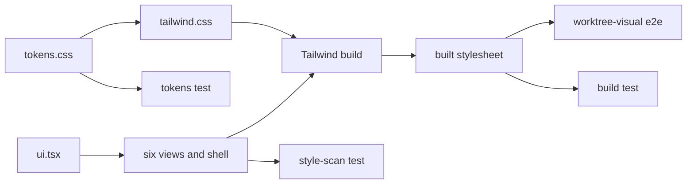

# Design Document

## Overview

This design adds one token file, `src/dashboard_frontend/src/modules/theme/tokens.css`, rewrites `tailwind.css` as a small base stylesheet, deletes `theme.css`, and adds one shared UI module every page uses for its component kinds. It changes no route, provider, data hook or server file. It reuses Tailwind's theme layer (`@theme static`) so utilities resolve to token values, and the worktree e2e harness for browser checks and screenshots.

## Steering Document Alignment

### Technical Standards (tech.md)
No `tech.md` exists (the steering directory is empty); the design follows `agent-rules.md`: vitest under `src/**/__tests__/`, worktree Playwright specs for browser checks.

### Project Structure (structure.md)
No `structure.md` exists; frontend files go under `src/dashboard_frontend/src/modules/` (`theme/`, a new `ui/`), unit tests under `src/dashboard/__tests__/` (Requirement 2.1), browser checks under `e2e/` with a `worktree-` prefix (`./playwright.worktree-pattern.ts:21`).

### Design System (design-system.md) — if applicable
N/A: no `design-system.md` exists; C1 and C3 become the dashboard's design system.

## Architecture

`tokens.css` holds every value; `tailwind.css` imports Tailwind then `tokens.css` then base rules, so utilities and `var()` references read the same values. `modules/ui/ui.tsx` holds one definition per component kind; pages swap their inline class strings for it without changing element types, attributes or text. Three vitest files check source and build; one worktree e2e file checks computed styles and captures the screenshots.



## Components and Interfaces

### C1 — Token file `src/dashboard_frontend/src/modules/theme/tokens.css`
- **Purpose:** the only file under FE that declares token values (Requirement 1.1).
- **Interfaces:** three top-level blocks, in this order:
  1. `@theme static { … }` — theme-independent tokens. Inside it, each namespace clear (`--font-*: initial`, `--text-*: initial`, `--font-weight-*: initial`, `--leading-*: initial`, `--radius-*: initial`, `--shadow-*: initial`, `--color-*: initial`) comes before that namespace's names, because a clear drops names declared before it. `static` emits every name, including ones no utility uses (`--sidebar-w`). Both are probe-verified (codebase-context).
  2. `:root { … }` — the light colour and shadow tokens only.
  3. `.dark { … }` — the dark colour and shadow tokens only, the same names as `:root`. It comes after `:root`: equal specificity means the later block wins when `src/dashboard_frontend/src/modules/theme/ThemeProvider.tsx:19-22` puts `dark` on `html`.
- The names and values are in Data Models. Values are `#rrggbb` for every colour that is part of a contrast pair; the scrim and the shadows may use `rgb(… / alpha)`.
- **Dependencies:** none. Imported only by `tailwind.css`.
- **Reuses:** the font stacks and the effective type and radius values of `src/dashboard_frontend/src/modules/theme/theme.css:7-51` (the unlayered values win today, so the operator sees 11/12/14 px type and a 6 px `rounded-md`).

### C2 — Base stylesheet `src/dashboard_frontend/src/modules/theme/tailwind.css` (rewritten)
- **Purpose:** the Tailwind entry and the few global rules that are not tokens.
- **Interfaces:** in order:
  1. `@import "tailwindcss";` then `@import "./tokens.css";` (the order the probe built).
  2. `@layer base` rules: `html, body, #root { height: 100% }`; `body` background, colour, font family, size and line height from tokens (replacing `src/dashboard_frontend/src/modules/theme/theme.css:227-240`); `:root { color-scheme: light }` then `.dark { color-scheme: dark }` (Requirement 3.3, replacing `src/dashboard_frontend/src/modules/theme/tailwind.css:6-8`); `:focus-visible { outline: var(--focus-ring-width) solid var(--focus-ring); outline-offset: var(--focus-ring-offset) }` (Requirement 4.4, 4.5); `input[type="checkbox"], input[type="radio"] { accent-color: var(--accent) }`; and `@media (prefers-reduced-motion: reduce) { *, ::before, ::after { transition-duration: 0s !important; animation-duration: 0s !important } }` (Requirement 4.6; an important declaration in an earlier layer beats later layers).
- **Removed:** `@plugin "@tailwindcss/typography"` (no `prose` class exists under FE; the package stays in `package.json`, Requirement 6.6), `@variant dark` (Requirement 3.2 bans the variant), and every component class at `src/dashboard_frontend/src/modules/theme/tailwind.css:15-464`.
- **Also:** `theme.css` is deleted and its import line goes from `src/dashboard_frontend/src/main.tsx:7` (Requirement 1.5 removes `src/dashboard_frontend/src/modules/theme/theme.css:246-612`; its tokens move to C1, its base rules to this file). `src/dashboard_frontend/src/modules/theme/ThemeProvider.tsx:2` keeps its import of `./tailwind.css`.
- **Dependencies:** C1.

### C3 — Shared UI module `src/dashboard_frontend/src/modules/ui/ui.tsx` (new)
- **Purpose:** one definition per component kind (Requirement 4.1).
- **Interfaces** (illustrative — verify against the test fake):
  ```ts
  type Tone = 'success' | 'warning' | 'danger' | 'info' | 'accent' | 'neutral';
  type ButtonVariant = 'primary' | 'secondary' | 'danger' | 'ghost';
  function Button(props: { variant: ButtonVariant; size?: 'sm' | 'md' } & React.ButtonHTMLAttributes<HTMLButtonElement>): JSX.Element;
  function Pill(props: { tone: Tone } & React.HTMLAttributes<HTMLSpanElement>): JSX.Element;
  function TextInput(props: React.InputHTMLAttributes<HTMLInputElement>): JSX.Element;
  function Tab(props: { selected: boolean } & React.ButtonHTMLAttributes<HTMLButtonElement>): JSX.Element;
  const ui: { panel: string; popover: string; dialog: string; scrim: string; drawer: string;
    tablist: string; table: string; th: string; td: string; logView: string;
    navRow(active: boolean): string; groupHeader: string };
  ```
- **Post-conditions:**
  - Each component renders the element type it replaces and passes every other prop through, so test ids, roles, `aria-*`, handlers and children reach the DOM unchanged (Requirement 6.2).
  - `Button`, `Pill`, `TextInput`, `Tab` and the list `Row` add `data-ui` (the kind); `Button` also adds `data-variant` and `data-size`, `Pill` adds `data-tone`, and `Row` adds `data-selected`. These attributes are outside the Requirement 6.2 attribute set and give the e2e check (C7) a stable locator.
  - Every variant and tone is a full literal class string in a lookup object, because Tailwind finds classes by scanning literal text.
  - Colours come from token `var()` references; lengths from spacing steps or the var shorthand (`w-(--sidebar-w)`, `shadow-(--shadow-overlay)`), which the probe compiled.
  - Disabled and busy: one treatment, `disabled:opacity-(--disabled-opacity) disabled:cursor-not-allowed`, on every `Button` (Requirement 4.3). A busy button is passed `disabled` and keeps whatever label the page renders; the sign-in button keeps its two labels (`src/dashboard_frontend/src/modules/auth/LoginPanel.tsx:67`, D17).
  - Hover, selected and disabled looks use the state tokens (`--surface-hover`, `--surface-selected`, `--accent-solid-hover`, `--danger-solid-hover`, `--disabled-opacity`); transitions use `transition-colors`, which reads `--default-transition-duration` and `--default-transition-timing-function` (Requirement 4.6).
  - No component sets `outline-none` or a `focus:` ring; C2 draws the ring.
- **Button variants:** primary = `--accent-solid` background, `--text-on-accent` text; secondary = `--border-strong` border, `--text-secondary` text, hover `--surface-hover`; danger = `--danger-solid` background, `--text-on-accent` text; ghost = no border, `--text-muted` text, hover `--surface-hover`. The outlined Discard button at `src/dashboard_frontend/src/modules/shell/RunsPage.tsx:311-319` maps to `danger`, like its confirm step at `src/dashboard_frontend/src/modules/shell/RunsPage.tsx:301-309` (D18). A call site never adds colour classes to a `Button`, only layout (margin, width, flex).
- **Dependencies:** C1 names; React.

### C4 — Restyled shell and primitives
- `primitives.tsx` `Group` header uses `ui.groupHeader`; `Chips` uses the `Pill`-like chip recipe with active state `--accent-solid` and `--text-on-accent` (replacing `src/dashboard_frontend/src/modules/shell/primitives.tsx:89-93`); `SearchBox` renders `TextInput` (drops `focus:outline-none focus:ring-2` at `src/dashboard_frontend/src/modules/shell/primitives.tsx:131`); `Pager` buttons render `Button variant="secondary" size="sm"`; `Row` keeps `style={{ height: 'var(--row-h)' }}`, uses `--surface-selected` when selected, `--surface-hover` on hover, `rounded-sm` instead of bare `rounded`, and adds `data-ui="row"` and `data-selected`.
- `Sidebar.tsx`: nav rows use `ui.navRow(active)` (active row `--surface-selected` background, `--text-primary` text); desktop aside `lg:w-(--sidebar-w)` (was `lg:w-64` at line 113); drawer panel `w-(--sidebar-w)` with `ui.drawer` (line 138); scrim `ui.scrim`, background `--scrim` (line 136).
- `src/dashboard_frontend/src/modules/shell/Gear.tsx:63` popover uses `ui.popover`; the theme button keeps its labels and control (Requirement 3.4) and becomes `Button variant="secondary" size="sm"`.
- `LoginPanel.tsx`: overlay `ui.scrim`, form `ui.dialog` (drops bare `shadow-lg` at line 44), input `TextInput`, submit `Button variant="primary"`.
- `src/dashboard_frontend/src/modules/shell/PageLayout.tsx:22` panel `xl:w-(--panel-w)` (was `xl:w-96`).
- `src/dashboard_frontend/src/modules/app/App.tsx:20`: `main` keeps `px-4 sm:px-6` (16 and 24 px from `--spacing: 4px`, Requirement 5.5) and wraps `Routes` in `div.mx-auto.w-full.max-w-(--content-max)`, so content is at most 1600 px and centred right of the sidebar (Requirement 5.4).
- `src/dashboard_frontend/src/modules/shell/ShellProvider.tsx:142` writes `var(--row-h-compact)` or `var(--row-h-comfortable)` to `--row-h` (Requirement 1.2); C1 declares `--row-h: var(--row-h-comfortable)` as the default before the effect runs.

### C5 — Status tone maps
Each map keeps its keys and meaning and maps to a `Tone`; the page renders `Pill tone={…}` (D14).

| Map | Statuses → tone |
| --- | --- |
| `src/dashboard_frontend/src/modules/shell/RunsPage.tsx:188-196` | running, merging → accent; paused, waiting → warning; error → danger; queued, done, abandoned → neutral |
| `src/dashboard_frontend/src/modules/shell/RunPage.tsx:305` wait pill | warning |
| `src/dashboard_frontend/src/modules/shell/RunPage.tsx:453-457` | done → success; in-progress → accent; open → neutral |
| `src/dashboard_frontend/src/modules/shell/SpecsPage.tsx:30-35` | live, in-progress → accent; closed → success; deferred, not-started → neutral |
| `src/dashboard_frontend/src/modules/shell/SpecsPage.tsx:232-235`, `src/dashboard_frontend/src/modules/shell/DeferralsPage.tsx:48-51` | deferred → accent; resolved → success; superseded → neutral |
| `src/dashboard_frontend/src/modules/shell/NowPage.tsx:88` phase chip | accent |

`src/dashboard_frontend/src/modules/shell/pause.ts:48` returns `text-(--tone-warning-fg)`, or `text-(--tone-danger-fg)` when overdue. Error text (`src/dashboard_frontend/src/modules/shell/NowPage.tsx:142`, 208, 248, 727 and every `--status-error` text) uses `--tone-danger-fg`.

### C6 — Usage chart and bar
- `src/dashboard_frontend/src/modules/shell/UsageTrend.tsx:13` `SERIES` becomes `['var(--chart-1)', …, 'var(--chart-6)']`; the cycle by project-name order stays (Requirement 2.4).
- The series colour and the axis colour move from SVG attributes (`stroke=`, `fill=` at lines 88, 98, 109, 116) to `style={{ stroke }}` and `style={{ fill }}` (D13); `strokeWidth`, `r` and the view-box numbers stay unitless SVG attributes.
- `src/dashboard_frontend/src/modules/shell/UsagePage.tsx:52-56` bar colour: `var(--tone-danger-fg)` when hot, else `var(--accent)`.

### C7 — Tests and the capture script
- **T1 `src/dashboard/__tests__/frontend-style-scan.test.ts`** (new). Walks every `.ts`, `.tsx`, `.css` file under FE except `modules/theme/tokens.css` and `assets/fonts/fonts.css`, line by line, and collects hits for these rules (the regexes are in the prototype `/tmp/scratchpad/sdd/dashboard-visual-refresh/probe/scan/scan.cjs`; the tasks author copies them in):
  - hex colour (3, 4, 6, 8 digits, not after `&` or a word character);
  - `rgb(`, `rgba(`, `hsl(`, `hsla(`, `oklch(`; `color-mix(` with a literal colour argument;
  - palette class: `white`, `black` or a named palette shade after any colour prefix, with any variant chain and an optional `/opacity`;
  - `var(--x, literal-colour)`;
  - arbitrary length class (`min-w-[7rem]`);
  - `dark:` variant (Requirement 3.2);
  - a `px` or `rem` literal inside an inline `style={{ … }}`;
  - a `var(--name)` whose name C1 does not declare (Requirement 1.4; also covers `--name` in `(--name)` shorthand);
  - a custom-property declaration (`--name:` in CSS, `setProperty('--name', value)` in TS) outside C1, except `setProperty('--row-h', 'var(--row-h-…)')` (Requirement 1.1);
  - a class selector other than `.dark` in `tailwind.css`, or any file named `theme.css` under FE (Requirement 1.5);
  - a `text-SIZE`, `rounded-X`, `shadow-X`, `font-WEIGHT`, `leading-X` utility whose theme name C1 does not declare, and the bare `rounded` and `shadow` (a cleared namespace makes these compile to nothing, silently; probe).
  On failure the message lists `file:line rule matched-text`, one per hit (Requirement 2.2). Red on base: the prototype finds 83 hits outside `modules/theme`, including all six sites Requirement 2.3 names.
- **T2 `src/dashboard/__tests__/frontend-tokens.test.ts`** (new). Parses C1 into its three top-level blocks by a small brace-matching reader (no CSS parser package, Requirement 6.6) and asserts: the `:root` and `.dark` blocks declare the same set of names (Requirement 3.1); no name is in both the `@theme static` block and a theme block; every name in Data Models is declared; every contrast pair in Data Models meets its ratio in both themes, using the WCAG relative-luminance formula on the `#rrggbb` values (NFR Accessibility). Red on base: `tokens.css` does not exist.
- **T3 `src/dashboard/__tests__/frontend-build.test.ts`** (new). Runs `process.execPath node_modules/vite/bin/vite.js build --config src/dashboard_frontend/vite.config.ts --outDir <tmp> --emptyOutDir` with `spawnSync` and a 120 s timeout, asserts exit status 0, reads the one `assets/*.css` file, and asserts each name C1 declares has one declaration in the theme layer, or one in `:root` and one in `.dark`, and no other declaration (Requirement 1.3). It reads only `status`, `stdout` and `stderr` (node 20 fields); a timeout gives `status` null (local probe), reported as a failure. Both flags are in the installed vite 7.3.0 `build --help`. Red on base: the probe found two `--text-sm` and two `--radius-md` values.
- **T4 `e2e/worktree-visual.spec.ts`** (new, worktree config). One serial suite on its own `WorktreeHarness` (`e2e/helpers/worktree-harness.ts:288`), seeded by a new helper `e2e/helpers/shell-seed.ts` that copies the fixture code of `e2e/worktree-shell.spec.ts:51-81` and `:91-196` (that function is module-private, and Requirement 6.4 forbids editing the existing file). Tests:
  1. Cross-view sameness (Requirement 4.1): for each of `row`, `pill`, `button`, find one instance present on two different views and matched on the attributes that drive its look — `data-tone` for the pill, `data-variant` and `data-size` for the button, `data-ui="row"` with `data-selected="false"` for the row — read `getComputedStyle` background colour, colour, border, border radius, height, padding and font size in the resting state (mouse parked off the element), and assert equal. It fails, naming the kind, if no pair exists; the tasks author confirms the seed gives one per kind.
  2. Focus ring (Requirement 4.4): on each view, press Tab up to 40 times; for each focused element assert `outline-style` is not `none`, `outline-width` is at least 2 px, and the outline colour has at least 3:1 contrast against the nearest opaque ancestor background, in both themes.
  3. Mouse focus (Requirement 4.5): click a nav link and a button; assert `outline-style` is `none` on the clicked element.
  4. Native controls (Requirement 3.3): with the OS emulated as light (`page.emulateMedia({ colorScheme: 'light' })`) and the theme set to dark, `getComputedStyle(document.documentElement).colorScheme` is `dark`, and the reverse.
  5. Reduced motion (Requirement 4.6): with `reducedMotion: 'reduce'`, a nav link's `transition-duration` is `0s`.
  6. Width cap (Requirement 5.4): at 1920 px the routes wrapper is at most 1600 px wide and its left and right gaps inside `main` differ by at most 1 px.
  7. No sideways scroll (Requirement 5.6): six views × 360, 768, 1000, 1440, 1920 px × two themes; the Run view opens the seeded run.
  The theme is set before load with `page.addInitScript` writing `localStorage.theme`, the same key `src/dashboard_frontend/src/modules/theme/ThemeProvider.tsx:15` reads. `page.emulateMedia` takes `colorScheme` and `reducedMotion` and `page.addInitScript` takes a function in the installed Playwright 1.58.0 (`node_modules/playwright-core/types/types.d.ts:2571-2602`, `:307`).
- **T5 capture block in `e2e/worktree-visual.spec.ts`** (Requirement 7.1, 7.2). A `describe` that calls `test.skip` unless both `SCREENSHOT_SET` (`before` or `after`) and `SCREENSHOT_DIR` are set, so the normal e2e run captures nothing. It writes `SCREENSHOT_DIR/SCREENSHOT_SET/view-theme.png` for the six views (`now`, `runs`, `run`, `specs`, `usage`, `deferrals`) in `light` and `dark` at 1440 × 900, opening the first row's panel on Runs, Specs and Deferrals; with `SCREENSHOT_SET=after` it also writes `view-dark-375.png`. `SCREENSHOT_DIR` is the spec directory's `screenshots` path; the brief passes it and relocates the files to the main store at the merge gate (agent-rules). The before set is captured on the commit that adds this block and no frontend change.

## Data Models

### Theme-independent tokens (`@theme static` block)
```
--font-sans: 'Inter', system-ui, -apple-system, "Segoe UI", sans-serif
--font-mono: 'JetBrains Mono', ui-monospace, Menlo, monospace
--text-xs: 11px      --text-xs--line-height: 16px
--text-sm: 12px      --text-sm--line-height: 18px
--text-base: 14px    --text-base--line-height: 20px
--text-lg: 16px      --text-lg--line-height: 24px
--font-weight-normal: 400   --font-weight-medium: 500
--font-weight-semibold: 600 --font-weight-bold: 700
--leading-tight: 1.25       --leading-normal: 1.5
--tracking-wide: 0.025em
--spacing: 4px
--radius-sm: 4px  --radius-md: 6px  --radius-lg: 8px  --radius-full: 9999px
--border-width: 1px
--focus-ring-width: 2px   --focus-ring-offset: 1px
--default-transition-duration: 120ms
--default-transition-timing-function: cubic-bezier(0.2, 0, 0, 1)
--disabled-opacity: 0.4
--row-h-comfortable: 36px  --row-h-compact: 32px  --row-h: var(--row-h-comfortable)
--sidebar-w: 256px  --panel-w: 384px  --content-max: 1600px
```

### Theme tokens (`:root` light / `.dark` dark)
Mock base values from `docs/mockups/sdd-dashboard-linear.html:8-18`; adjusted values are marked *adj* with the failing mock ratio.

| Token | Light | Dark |
| --- | --- | --- |
| `--surface-base` | `#fcfcfc` | `#0f1011` |
| `--surface-panel` | `#ffffff` | `#121314` |
| `--surface-inset` | `#f4f5f7` | `#1b1d21` |
| `--surface-hover` | `#f0f0f3` | `#1f2126` |
| `--surface-selected` | `#ecedfa` | `#21223a` |
| `--surface-overlay` | `#ffffff` | `#18191b` |
| `--text-primary` | `#282a30` | `#e3e4e6` |
| `--text-secondary` | `#4b505a` | `#b4b7bd` |
| `--text-muted` | `#646975` *adj* (mock `#6f7480`, 4.29 on inset) | `#8a8f98` |
| `--text-on-accent` | `#ffffff` | `#ffffff` |
| `--border-default` | `#e8e8ec` | `#23252a` |
| `--border-strong` | `#80858f` | `#6a6f7b` |
| `--accent` | `#5e6ad2` | `#7170ff` |
| `--accent-solid` | `#5e6ad2` | `#5b5bd6` *adj* (white on `#7170ff` is 3.84) |
| `--accent-solid-hover` | `#4f5bc4` | `#4c4cc4` |
| `--danger-solid` | `#c93b40` | `#c62f35` |
| `--danger-solid-hover` | `#b0333a` | `#a8282e` |
| `--focus-ring` | `#5e6ad2` | `#7170ff` |
| `--tone-success-fg` / `-bg` | `#1f7a48` *adj* (mock `#2f9e5f`, 3.40) / `#e6f3ec` | `#4cb782` / `#1b2d26` |
| `--tone-warning-fg` / `-bg` | `#8a5a00` *adj* (mock `#c98500`, 3.07) / `#f7eedb` | `#f2c94c` / `#312c1c` |
| `--tone-danger-fg` / `-bg` | `#c4343a` *adj* (mock `#e5484d`, 3.91) / `#fce9ea` | `#f06a6a` / `#351e1f` |
| `--tone-info-fg` / `-bg` | `#1f63b8` / `#e5effa` | `#5b9cf0` / `#182635` |
| `--tone-accent-fg` / `-bg` | `#4f5bc4` / `#ecedfa` | `#8f8fff` / `#21223a` |
| `--tone-neutral-fg` / `-bg` | `#646975` / `#f4f5f7` | `#8a8f98` / `#1b1d21` |
| `--chart-1` … `--chart-6` | `#2a78d6`, `#d5561f`, `#138a5f`, `#b07800`, `#8e4ec6`, `#0e7c86` | `#3987e5`, `#d95926`, `#199e70`, `#c98500`, `#a56de2`, `#1fa3ad` |
| `--scrim` | `rgb(0 0 0 / 0.4)` | `rgb(0 0 0 / 0.6)` |
| `--shadow-overlay` | `0 4px 16px rgb(0 0 0 / 0.12)` | `0 4px 16px rgb(0 0 0 / 0.5)` |

Light chart series 2-4 are darker than the mock (mock ratios 3.20, 2.82, 2.17 on white); series 5 and 6 are new. Tone backgrounds are the hue mixed into `--surface-panel` at 12-16 %, stored opaque.

Every other `theme.css` name (`--interactive-*`, `--accent-primary*`, `--status-*`, `--border-focus`, aliases) is removed; references move to a name above, and T1 fails on any left.

### Contrast pairs T2 checks (both themes)
- 4.5:1 — `--text-primary`, `--text-secondary`, `--text-muted` on each of `--surface-base`, `--surface-panel`, `--surface-inset`, `--surface-hover`, `--surface-selected`, `--surface-overlay`; `--accent` on `--surface-base` and `--surface-panel`; `--text-on-accent` on `--accent-solid`, `--accent-solid-hover`, `--danger-solid`, `--danger-solid-hover`; each `--tone-X-fg` on its `--tone-X-bg` and on `--surface-panel`; `--tone-danger-fg` on `--surface-base`.
- 3:1 — `--focus-ring` and `--border-strong` on `--surface-base`, `--surface-panel`, `--surface-inset`, `--surface-overlay`; `--focus-ring` on `--surface-hover` and `--surface-selected`; each `--chart-N` on `--surface-panel`.
All pass (computed with `/tmp/scratchpad/sdd/dashboard-visual-refresh/probe/cx/pal.cjs`; lowest are light `--accent` on `--surface-base` 4.58 and light `--tone-danger-fg` on its bg 4.61).

## Error Handling

1. **A utility in a cleared namespace is not declared in C1** (`rounded-xl`, `text-2xl`): Tailwind emits no rule and no error; the element falls back silently. T1's utility-name rule fails with `file:line` before the build ships.
2. **A component carries a literal colour or length:** T1 fails and names `file:line rule matched-text`; the fix is a token, never an allowlist entry. Only C1 and `fonts.css` are exempt.
3. **The vite build in T3 fails or times out:** the test fails with the exit status and the last 2,000 characters of `stderr`.
4. **An outline is clipped by an `overflow` ancestor:** not caught by T4.2 (it checks computed style, not pixels); the operator's screenshot review in Requirement 7.3 is the check, and the fix is an inset offset token added to C1.

## Testing Strategy

- **Unit (vitest, `npm test`):** T1, T2, T3 above, all new files under `src/dashboard/__tests__/` (covered by `./vitest.config.ts:8`). Red-first: T1 (Requirements 1.1, 1.4, 1.5, 2.1-2.3, 3.2), T2 (3.1, NFR Accessibility), T3 (1.3). Requirement 1.2 is proved by T1's `setProperty` rule plus the existing density e2e (`e2e/worktree-shell.spec.ts:242-256`), unedited.
- **End-to-end (worktree Playwright, `npm run test:e2e:worktree`):** T4 in `e2e/worktree-visual.spec.ts`. Red-first: T4.1 (4.1), T4.2 (4.4), T4.4 (3.3), T4.5 (4.6), T4.6 (5.4). Regression guards (hold at base; the tasks author runs them on base first): T4.3 (4.5, mouse focus shows no ring today), T4.7 (5.6). The existing suites run unedited and must stay green (Requirement 6.4, 7.4).
- **Invariants checked at the verification gate, not as red tests:** Requirement 3.4, 5.1, 5.2, 5.3, 5.5, 5.7, 6.1-6.7. The gate diffs the sorted Requirement 6.2 grep output of base and branch; `git diff --name-only` against base limited to `src/dashboard_frontend/`, the new test files and this spec's directory (6.3); `git diff` of `package.json` lines 56-108 is empty (6.6); a search of FE for `min-[`, `max-[` and width `@media` finds none (5.1); the built stylesheet from `npm run build:dashboard` is no larger than base (NFR Performance; probe 24.62 kB against 54.58 kB).
- **Evidence (Requirement 7):** T5 `before` on the first commit, `after` at the end; `verification-evidence.md` holds one `pending` line per view until the operator marks it `passed`; then the four commands of 7.4.

## Decisions taken in this document

- D1 — Token file location: a new tokens file in the theme module, old stylesheet deleted; over rewriting it in place, chosen because a fresh file holds only tokens and the scan exempts it by name.
- D2 — Theme-independent tokens live in Tailwind's static theme block, not a plain selector; chosen because only the theme block makes utilities resolve to the token values (Requirement 1.3). Departs from Requirement 3.1's word "selector" (RE-DECIDED).
- D3 — Clear the Tailwind font, type, weight, leading, radius, shadow and colour namespaces before declaring them; over overriding only names in use, chosen because a clear leaves one value per name and kills palette classes; the scan catches the silent gap.
- D4 — Keep today's effective sizes (11, 12, 14 px type, 6 px medium radius); over Tailwind defaults or the mock's 12.5 px, chosen so the operator sees no size jump.
- D5 — Shared definitions are one UI module of small components plus class constants, stamped with a kind attribute; over CSS component classes or class constants alone, chosen because components keep element types and props intact.
- D6 — Token names: keep the surface, text and border names the pages use; replace the interactive, accent-primary and status names with accent, solid and tone names; over keeping or renaming everything, chosen because it limits churn to names whose meaning changes.
- D7 — Tone backgrounds are opaque values in the token file, not a call-site colour mix; chosen because the contrast test needs a concrete colour and the scan bans literal mixes.
- D8 — Palette adjustments: light muted text, light success, warning and danger text, dark solid accent, light chart series 2-4 darkened; chart series 5 and 6 added; over keeping the mock, chosen because each mock value fails the contrast rule (ratios in Data Models).
- D9 — Focus ring is one global focus-visible outline, 2 px, accent colour, 1 px offset; over per-component rings, chosen because it covers every focusable element, including ones no component wraps.
- D10 — Native controls take the accent colour and the selected theme's colour scheme; over custom-drawn controls, chosen because native ones keep their behaviour.
- D11 — The built-stylesheet check is a vitest test that runs the vite build; over a gate-only check, chosen because Requirement 1.3 is a build property and the build takes about two seconds.
- D12 — Browser checks and screenshot capture share one new worktree e2e file with a seed helper copied from the shell suite; over editing the shell suite or two new files, chosen because the shell suite may not be edited and one file pays the harness setup once.
- D13 — Chart colours move to the style attribute; over keeping presentation attributes, chosen because the style attribute certainly resolves custom properties.
- D14 — Live and in-progress both map to the accent tone, deferred and not-started both to neutral; over splitting them across accent and info, chosen because they share a colour today and the meaning must not change.
- D15 — Disabled opacity is 0.4 everywhere; over 0.5, chosen because 0.4 is the more common of the two today.
- D16 — The typography plugin import and the dark variant line are removed from the stylesheet; the package stays; chosen because nothing uses them and the variant is banned.
- D17 — A busy button keeps today's busy label swap; over one fixed label, chosen because Requirement 6.2 forbids changing label text and Requirement 4.3 only bars a spinner replacing it.
- D18 — The outlined Discard button becomes the solid danger variant; over a fifth outlined-danger variant or the secondary variant, chosen because Requirement 4.1 names four variants and Discard is destructive.

## Scope notes

- Carried items from requirements: none.
- Toasts, translations and the terminal HUD: cut in requirements.
- The `info` tone is defined but no status maps to it today (D14).
- Frontend type checking stays absent (requirements Scope notes); T1-T3 do not add one.

## Revision History

- **v2** (2026-10-28) — Round-1 adversarial response (adversarial-analysis-design.md, verdict iterate 1/1/1).
  - **R1-1 — Accepted (MUST_FIX).** C6 now cites line 88 for the axis stroke, keeping 98/109/116 for the series, and still moves the axis colour to the style attribute; the same slip is fixed in the context file.
  - **R1-2 — Accepted (SHOULD_FIX).** T4.1 now matches button size and an unselected row, not tone and variant alone, and the UI module stamps the size, selection and row-locator attributes, so the equality holds and the pair is addressable.
  - **R1-MINOR — Partially accepted (MINOR).** Named the active nav-row tokens, both already declared and contrast-checked.
- **v1** (2026-10-28) — Initial draft.
  - **Lint pass.** 31 citations prefixed; rejected: L-30 ('theme' anchors to `ThemeProvider.tsx:15`, which L-31 resolves), L-32 ('setProperty' is T1's rule, not the cited e2e; rule 11 suppresses).
