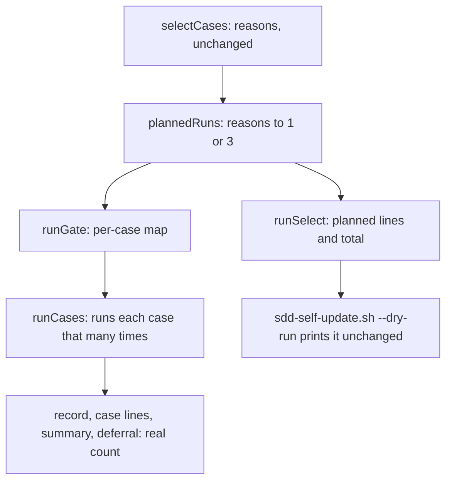

# Design Document — eval-gate-runs

## Overview

The gate sets each selected case's run count from the reasons that selected it, through one new function, and the runner takes a per-case count beside its uniform `runs` option. The change sits in `src/evals/`: `select.ts` holds the rule, `runner.ts` applies it, and `gate.ts` and `cli.ts` report the counts. It reuses the runner loop, the result record, the `select` command and the dry-run path, so `scripts/sdd-self-update.sh` needs no edit.

## Steering Document Alignment

### Technical Standards (tech.md)
N/A: the steering directory holds no `tech.md`, so the design follows the checks in `.spec-workflow/agent-rules.md`.

### Project Structure (structure.md)
N/A: the steering directory holds no `structure.md`; this design adds no new source or test file, and new tests go in the existing `__tests__` files.

### Design System (design-system.md) — if applicable
N/A: this spec has no visual surface.

## Architecture

`selectCases` keeps its output. A new pure function turns a case's reasons into a count, and two callers use it: `runGate` builds a per-case map for the runner, and `runSelect` prints the plan. Exact `select` and the gate therefore agree by construction (R1 AC4, R4 AC5). The real count reaches the reports from the length of each case's `runs` list, so the record changes in content only.



## Components and Interfaces

### Component 1 — the run-count rule (`src/evals/select.ts`)
- **Purpose:** The one definition of the reason-to-count rule (R1 AC1, AC3, AC4).
- **Interfaces:** `export function plannedRuns(reasons: string[]): 1 | 3`.
- **Post-conditions:**
  1. It returns 1 when every reason is indirect. A reason is indirect when it equals `role`, equals `profile`, or starts with `brief`. That prefix covers all three brief forms (`src/evals/select.ts:131`, `src/evals/select.ts:153`, `src/evals/select.ts:200`).
  2. It returns 3 in every other case. So a `case` or `grader <name>` reason gives 3, alone or with other reasons, and a reason this function does not know also gives 3 (D2).
  3. The caller passes a non-empty list. `selectCases` keeps a case only when it has a reason (`src/evals/select.ts:204`).
- **Unchanged:** `SelectedCase` (`src/evals/select.ts:19-23`) gains no field, and the reason strings and `selectCases` stay as they are (R1 AC5).
- **Dependencies:** None.
- **Reuses:** The reason strings built at `src/evals/select.ts:184-200`, in the same file, so a new reason string and the rule sit together.

### Component 2 — the per-case count (`src/evals/runner.ts`)
- **Purpose:** Runs each case the number of times its caller states, while the uniform option keeps working.
- **Interfaces:** `RunCasesOpts` (`src/evals/runner.ts:42-49`) gains the optional `runsByCase?: ReadonlyMap<string, number>`. `runCases` keeps its signature.
- **Post-conditions:**
  1. For a case id in `runsByCase`, the case runs that many times.
  2. For a case id not in `runsByCase`, or with no map, the case runs `opts.runs ?? 3` times (R1 AC6, AC7). The count resolves per case inside the loop at `src/evals/runner.ts:160`, replacing the single value at `src/evals/runner.ts:144`.
  3. Each case's `runs` array holds one entry per real run (R3 AC3). The verdict rule (`src/evals/runner.ts:246-250`), the run loop that keeps going after a failed run (`src/evals/runner.ts:165-243`), the case line (`src/evals/runner.ts:253-254`) and the record's `v: 1` stay as they are (R2 AC3, AC4, R3 AC4).
  4. The doc comment at `src/evals/runner.ts:137-140` stops saying "3 times".
- **Dependencies:** None new.
- **Reuses:** The loop and record code named above.

### Component 3 — the gate (`src/evals/gate.ts`)
- **Purpose:** Applies the rule and states real counts in the failure summary and the override deferral.
- **Interfaces:** `RunGateOpts` (`src/evals/gate.ts:8-18`) gains the optional trailing `onLine?: RunCasesOpts['onLine']`. `RunGateResult` does not change.
- **Post-conditions:**
  1. `runGate` builds `runsByCase` from `selected` with `plannedRuns`, and passes it and `opts.onLine` in the `runCases` call at `src/evals/gate.ts:56-58` (R1 AC1-3, R3 AC1).
  2. Each part of the summary at `src/evals/gate.ts:76` reads `<id> <verdict> <passed>/<runs> <first reason>`. `<passed>` counts the case's runs with verdict `pass`; `<runs>` is `c.runs.length`. The `<target 12>: ` start and `; record <path>` end stay (R3 AC2).
  3. `revisitCriteria` at `src/evals/gate.ts:96` reads `case <id> passes <n>/<n>`, with `n` equal to `c.runs.length` (R3 AC5, AC6).
  4. The override checks and their exit codes (`src/evals/gate.ts:45-49`, `src/evals/gate.ts:66-72`), the exit-1 guard (`src/evals/gate.ts:74`), `revisitTrigger`, the deferral context and the `overrides.log` line stay as they are (R2 AC1, AC2, R3 AC7).
- **Dependencies:** Component 1, Component 2.
- **Reuses:** `firstReason` (`src/evals/gate.ts:25-30`).

### Component 4 — the CLI (`src/evals/cli.ts`)
- **Purpose:** Prints the gate's case lines and the planned counts.
- **Interfaces:** No new flag; `USAGE`, the parsers and the exit codes do not change.
- **Post-conditions:**
  1. `runGateCommand` (`src/evals/cli.ts:171-187`) passes `onLine: (line) => console.log(line)` to `runGate`, the same way `runRun` does at `src/evals/cli.ts:141` (R3 AC1).
  2. `runSelect` (`src/evals/cli.ts:151-169`) appends `: <n> run` or `: <n> runs` after the existing line, including after any ` (provisional)` marker, with `n` from `plannedRuns(s.reasons)` (R4 AC1).
  3. After the case lines, `runSelect` always prints one total line in the grammar under Data Models, for an empty selection too (R4 AC2, AC3).
  4. `runRun` (`src/evals/cli.ts:128-149`) does not change, so a direct run passes no count and stays at 3 (R1 AC6).
- **Dependencies:** Component 1, Component 3.
- **Reuses:** The `onLine` pattern at `src/evals/cli.ts:141`.

### Component 5 — the deploy script (`scripts/sdd-self-update.sh`, no edit)
- **Purpose:** Enumerated because the entry names it. It needs no change.
- **Post-conditions, all holding through existing code:**
  1. The dry run sends `select` stdout straight to its own stdout (`scripts/sdd-self-update.sh:232-234`), so the new lines appear with no script edit (R4 AC6).
  2. The missing-CLI message stays (`scripts/sdd-self-update.sh:236`, R4 AC7).
  3. The gate's new case lines go to the script's stdout (`scripts/sdd-self-update.sh:248`), which the Deploy action logs to `deploy.log` (`src/advisor/actions.ts:367-369`).
  4. The summary file still becomes the `error` wait detail (`scripts/sdd-self-update.sh:252-258`, R2 AC5).

### Component 6 — the harness documentation (`docs/SDD-HARNESS.md`)
- **Purpose:** Stops the docs promising 3 runs on every gate (R5).
- **Edits, at four sites:**
  1. `docs/SDD-HARNESS.md:492-494`: the `error` wait gives each failing or inconclusive case's run count (R5 AC3).
  2. `docs/SDD-HARNESS.md:504-506`: the dry run prints each selected case's planned count and the total, and it uses the live `dist/evals/cli.js`, not the staged one (R5 AC2).
  3. `docs/SDD-HARNESS.md:510-511`: state the gate's rule: 3 runs for a case with a `case` or `grader` reason, 1 run for a case selected only by `role`, `profile` or brief reasons (R5 AC1).
  4. `docs/SDD-HARNESS.md:537-539`: a direct run stays at 3 runs per case (R5 AC1).

## Data Models

The result record (`src/evals/runner.ts:18-40`) and `SelectedCase` do not change.

**Readers of the record.** `EvalResultRecord`, `EvalCaseRecord` and `evals/results` appear only under `src/evals/`, and nothing in `scripts/` or `harness/` reads a record or parses `select` output. The readers of the returned record are `src/evals/gate.ts:66-81`, `firstReason` and `src/evals/cli.ts:148`. All read verdicts or reasons, and none assumes 3 runs.

The output lines, where `<count>` is `<n> run` for 1 and `<n> runs` otherwise:

```
select <id>: <reasons>: <count>
select <id>: <reasons> (provisional): <count>
select: <n> case|cases, <count>
select: <n> case|cases, <count> (provisional)
<target 12>: <id> <verdict> <passed>/<runs> <first reason>; ...; record <path>
```

The total line takes ` (provisional)` when any selected case has `provisional: true`.

## Error Handling

1. **The single run of a 1-run case fails or is inconclusive, and no override names it:** the case verdict is `fail` or `inconclusive`, the gate exits 1 with no retry, and the `error` wait reads for example `demo fail 0/1 <first reason>`.
2. **`runsByCase` lacks a selected id:** the runner falls back to `opts.runs ?? 3`, the higher count. `runGate` builds the map from the same list it passes as ids, so this path serves direct callers only.
3. **A provisional total differs from the gate's total:** a `brief source` case may drop out at the gate. The gate may also select a brief-only case that provisional mode did not, because exact mode compares renders while provisional mode looks at two files (`src/evals/select.ts:174-175`). In that second event the total can carry no ` (provisional)` marker, because no selected case was provisional (R4 AC3). A case that stays selected keeps its count either way (R4 AC4).
4. **Exact `select` runs with no `--base-dist`:** every case gets `brief: base render unavailable`, as at base, and a case with no other reason plans 1 run. The equality of R4 AC5 needs the same `--base-dist` as the gate.
5. **The live build predates this spec:** the dry run prints the old lines with no counts. The gate runs from the staged build, so it uses the new counts on that same deploy.

## Testing Strategy

The checks assert on the seams below. "Guard" marks an AC that holds at base: a regression guard, not a red test.

- **Unit, `src/evals/__tests__/select.test.ts`:** `plannedRuns` returns 1 for each of `role`, `profile`, `brief source`, `brief test-author` and `brief: base render unavailable`, and for a mix of those. It returns 3 for `case`, `grader x`, each of those with an indirect reason, and an unknown reason, alone or with `role`. The existing reason assertions stay (guard, R1 AC5).
- **Unit, `src/evals/__tests__/runner.test.ts`:** with a stub `step` of the shape at `src/evals/__tests__/runner.test.ts:378-394`, `runsByCase` of 3 and 1 gives records of 3 and 1 runs and the lines `pass 3/3` and `pass 1/1`. A case absent from the map takes `runs`. The tests at `src/evals/__tests__/runner.test.ts:200` and `src/evals/__tests__/runner.test.ts:242` stay (guards, R1 AC6, AC7).
- **Integration, `src/evals/__tests__/gate.test.ts`:**
  - Fixture for R1 AC2: `old-case` from `writeDeterministicCase` (`src/evals/__tests__/gate.test.ts:87-110`) at `base`, with `harness/agents/sdd-test-author.md`. `target` edits that role file and adds `new-case`. A `baseDist` from `writeMatchingBaseDist` (`src/evals/__tests__/gate.test.ts:160-174`) baked with `old-case`'s text leaves that case with only `role`. Count stub `step` calls by the case id in `logPath`: 3 for `new-case`, 1 for `old-case`.
  - The same run gives a record with 3 and 1 runs and `onLine` lines `pass 3/3` and `pass 1/1`.
  - A failing grader on the 1-run case gives exit 1 and a summary with `fail 0/1`. A stub `step` classified `usage-limit` gives exit 1 and `inconclusive 0/1`.
  - An override of the failed 1-run case gives exit 0 and `case <id> passes 1/1`.
  - A 3-run case that fails only its first run makes 3 step calls and reads `fail 2/3` (guard for the step count, R2 AC4).
- **Integration, `src/evals/__tests__/cli.test.ts`:**
  - `main(['select', ...])` on a fixture with both kinds of case prints both count forms and `select: 2 cases, 4 runs`. It prints `(provisional): 1 run`, a provisional `case`-reason line with `(provisional): 3 runs`, the total's ` (provisional)`, `select: 1 case, 1 run`, and `select: 0 cases, 0 runs`.
  - `main(['gate', ...])` prints the case lines (`captureStdout`, `src/evals/__tests__/cli.test.ts:76`).
  - R4 AC5: exact `select` and `gate` over one fixture with no `--base-dist` agree per case, and the stub's `.counter` file (`scripts/stub-claude.mjs:62-72`) equals the select total. This test needs no built `dist/`.
- **Script, `src/__tests__/service-scripts.test.ts`:** these tests assert only on the exit `code` and the `stdout` text of `runScript` (`src/__tests__/service-scripts.test.ts:24-34`), which node 20 guarantees.
  - R4 AC6, real CLI: a toy checkout with both kinds of case on `HEAD..origin/main`, with the role file at `harness/agents/` changed and one case added. The dry run does not fetch (`scripts/sdd-self-update.sh:176-178`), so the test runs `git fetch origin` itself. `<checkout>/dist/evals/cli.js` is a wrapper that dynamic-imports this repository's built `dist/evals/cli.js`, calls `main(process.argv.slice(2))` and exits with its code. The test asserts the count lines and the total, exit 0, an uncreated stub `.counter`, and the same HEAD and `git status --porcelain` before and after.
  - The wrapper is required. A symlinked `dist` exits 0 and prints nothing, because `src/evals/cli.ts:208-215` compares the unresolved `argv[1]` with the module's real path. The design probe confirmed both results on node 20.20.2 and 24.13.0 against a built `dist/`, with a toy `package.json` that has no `type` field.
  - This test needs a built `dist/`. CI builds before it tests (`.github/workflows/ci.yml:30`, `.github/workflows/ci.yml:33`), and a local run needs `npm run build` first, after the code changes. Without a build the test fails, with no skip.
  - Error wait (guard, R2 AC5): `stageBuildStub` (`src/__tests__/service-scripts.test.ts:74-76`) stages a gate that writes `demo fail 0/1 stub reason; record /x` to its `--summary-file` and exits 1. A stub `<checkout>/dist/controller/waits.js` records the wait text to a file under the test's home. The test asserts that text names `demo fail 0/1`, and that the stub file and HEAD are unchanged. Illustrative — verify against the test fake: the toy package has no `type` field, so the stub is CommonJS with `exports.createWait`; the probe confirmed `import()` exposes that name on both node versions.
- **Existing assertions:** this change alters one exact value, `src/evals/__tests__/gate.test.ts:369-371`, which becomes `fail-case fail 0/3 <reason>`; the comment at `src/evals/__tests__/gate.test.ts:337-338` follows. `src/evals/__tests__/cli.test.ts:283` still holds (a `toContain` on the prefix). `src/evals/__tests__/gate.test.ts:440`, `src/evals/__tests__/cli.test.ts:318` and `src/__tests__/service-scripts.test.ts:264` do not change. Every existing gate test that runs a step uses a case new at `target`, so that case has a `case` reason and keeps 3 runs and its 3-entry stub script.
- **End-to-end:** the entry's five scenarios map to the tests above. (1) and (2): the gate fixture. (3): the failing-grader gate test, the error-wait script test and `src/__tests__/service-scripts.test.ts:382-406`. (4): the override gate test. (5): the dry-run script test. The final gate runs `npm run build`, then `npm test`.
- **Performance NFR:** `3a + b` follows from R1 AC2's test and needs no separate test.

## Decisions taken in this document

- D1 — The rule is an exported function in the selection module, and the selected-case shape stays: options were a function beside the reason strings, a new module, a run-count field on the selected case; chosen because the rule parses strings built in that file, and an unchanged shape keeps R1 AC5 true with no test change.
- D2 — A reason the rule does not know gives 3 runs: options were list the indirect reasons and default to 3, list the direct reasons and default to 1; chosen because a future reason then costs tokens until someone classifies it, and it never silently weakens the gate. No reason of today takes this path.
- D3 — The per-case count is a new optional map beside the uniform option: options were a map, a callback, widening the uniform option's type, one runner call per count; chosen because a map is plain data, existing callers do not change, and one runner call keeps one result record per gate.
- D4 — The gate's case lines reach stdout through a new optional line callback that the CLI sets: options were that callback, printing inside the gate; chosen because it matches the direct run and keeps the gate function silent in its own tests.
- D5 — The deploy script gets no edit: options were no edit, a wrapper that reformats the output; chosen because the script already prints what the select command prints.
- D6 — The dry-run test runs the real CLI through a wrapper file in the toy checkout: options were a wrapper, a stub CLI with fixed lines, a symlinked build; chosen because a stub proves only forwarding and the probe showed a symlinked build prints nothing. The cost is that this test needs a built tree.
- D7 — A new regression guard asserts the error wait text: options were add it, rely on the existing failing-gate script test; chosen because the entry's third scenario says the case is named in the wait, and that existing test only asserts that the script wrote one.
- D8 — Run counts in reports come from the recorded runs, not from the plan: options were the recorded runs, the planned map; chosen because the requirements ask for the real count and the record already holds it.

## Scope notes

- Cut or deferred from the entry: none. The entry lists `scripts/sdd-self-update.sh`, and Component 5 enumerates it with no edit (D5); the requirements left that call to design.
- Carried from requirements: none.
- Correction to a requirement's evidence, with no change to the requirement: R3 AC4 says only `src/evals/gate.ts:66-81` and `firstReason` read the record inside `src/evals/`. `src/evals/cli.ts:148` also reads the returned verdicts. It assumes nothing about 3 runs, so the AC stands.
- Known consequence, not fixed here: the dry run does not fetch (`scripts/sdd-self-update.sh:176-178`), so its preview covers the last-fetched `origin/main`. This adds to the range note in the requirements.
- Unchanged, on purpose: `docs/ai-resources-catalogue.md:175-176` and the `harness/` tree, so no plugin sync is needed. This spec touches no path under the agent rules' sensitive list.

## Revision History

- **v1** (2026-11-04) — Initial draft.
