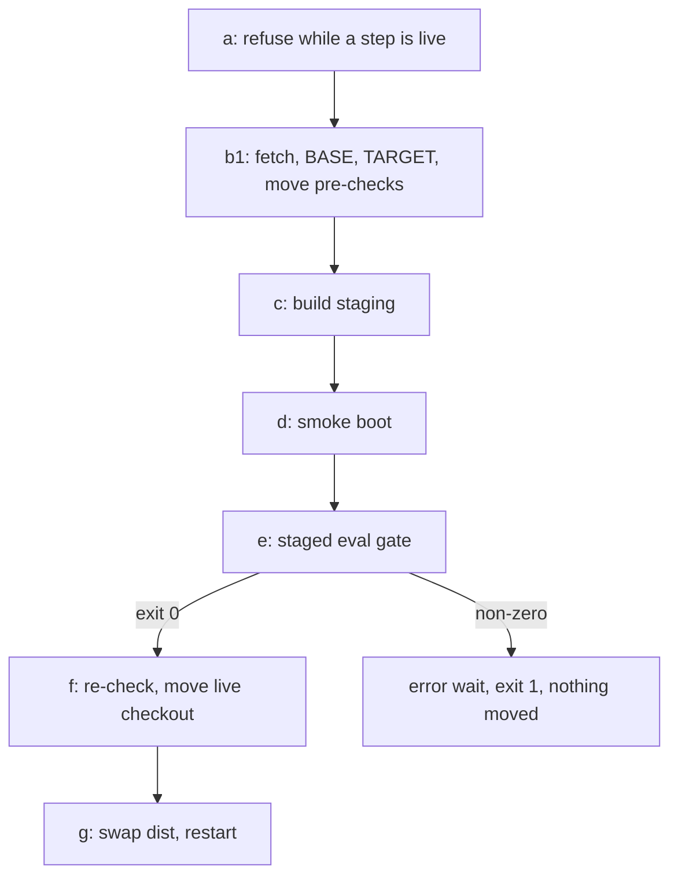

# Design Document — harness-evals

## Overview

This design adds an eval module in `src/evals/` (case loader, fixture builder, brief renderer, graders, runner, selector, deploy gate, CLI), five seed cases in `harness/evals/`, and an eval step in `scripts/sdd-self-update.sh`. The runner calls `runStep` (`src/controller/step.ts:343-516`) unchanged and renders briefs through the `harness` brief action the implementation and close-out phases call (`src/controller/phases/implementation.ts:501-502`, `src/controller/phases/closeout.ts:324-328`). It also edits the drafter template, the retro proposal format, the retro analyst role and the close-out standing brief.

## Steering Document Alignment

### Technical Standards (tech.md)
No `tech.md` exists; the design follows `agent-rules.md`: vitest tests next to each module, node 20 fields only, `/usr/bin/git` in scripts.

### Project Structure (structure.md)
No `structure.md` exists. Server code goes in `src/evals/` (built to `dist/evals/`, `tsconfig.json` `rootDir: ./src`), cases in `harness/evals/` (requirements D7), tests in `src/evals/__tests__/` (matched by `vitest.config.ts:8`).

### Design System (design-system.md) — if applicable
N/A: no visual surface.

## Architecture

The deploy gets an eval step between the smoke boot and the live-checkout move. The move splits: its refusal checks still run before the build, and the move itself runs after the eval step. The gate is TypeScript in the staged build; the shell only calls it and reads its exit code and summary file.



## Components and Interfaces

Every signature below is illustrative — verify against the test fake. The post-conditions bind.

### Component 1 — case loader (`src/evals/case.ts`)
- **Purpose:** Parse and validate `harness/evals/<id>/case.json`.
- **Interfaces:** `casesRoot(): string` (`harness/evals` under the package root, resolved as `harnessDir` does, `src/controller/step.ts:146-150`); `listCaseIds(root?: string): string[]` (sorted directories holding a `case.json`); `loadCase(id: string, root?: string): EvalCase`.
- **Post-conditions:** `loadCase` throws `CaseError` listing every problem: unknown or missing keys, an `id` unequal to the directory name, a `phase` outside `implementation | document | closeout`, a `(phase, role)` pair with no schema (Component 4), a `turnCap` that is not a positive integer, an unregistered grader (Component 5), a fixture path missing from the case directory.

### Component 2 — fixture builder (`src/evals/fixture.ts`)
- **Purpose:** Build a fresh git repository for one run (R1 AC3).
- **Interfaces:** `buildFixture(c: EvalCase, caseDir: string): Fixture`; `disposeFixture(f: Fixture): void`.
- **Post-conditions:**
  1. A new `mkdtemp` parent holds `repo/`, the fixture root. No two calls share a directory.
  2. Each `fixture.commits` entry, in order, copies its `tree` directory over the root and commits everything with its message, author `Eval Fixture`, hooks off for setup commits.
  3. `fixture.preCommitHook` is installed as `.git/hooks/pre-commit`, mode 755.
  4. Each `fixture.worktrees` entry gets `git worktree add -b <branch> .claude/worktrees/<dir>`, and `.claude/worktrees/` goes into `.git/info/exclude` (probe: git 2.43.0 made the worktree, then `git status --porcelain` printed nothing).
  5. `f.bases` records HEAD of the root and of each worktree after setup.
  6. A failure throws `FixtureError` and removes the parent.
- **Reuses:** `scrubbedGitEnv` from `src/core/git-utils.ts`, called as `src/controller/phases/closeout.ts:242-248` does.

### Component 3 — brief renderer (`src/evals/render.ts`)
- **Purpose:** Render every brief a case names from the build under evaluation (R1 AC2, requirements D1).
- **Interfaces:** `renderCaseBriefs(c: EvalCase, f: Fixture, scratch: string, handler?: BriefHandler): Promise<{ launchBrief: string; texts: Record<string, string> }>`; `handler` defaults to this build's `harnessHandler`.
- **Post-conditions:**
  1. In every `values` string, `{{fixture}}` becomes `f.root` and `{{scratch}}` becomes `scratch`, before render.
  2. Briefs render in listed order. An entry's `wire` map (`{ key: templateName }`) sets `values[key]` to the output path of the earlier brief of that template, so `closeout-batch`'s `standing` names the rendered `closeout-standing` (`src/tools/brief-templates.ts:1505`).
  3. Each brief renders through `handler({ action: 'brief', template, specName: c.spec, taskId, values: { ...values, path } }, { projectPath: f.root, workspacePath: f.root })` with `path = join(scratch, entry.file)`, the call shape of `src/controller/phases/implementation.ts:501-502`. The action honours an absolute path (`src/tools/harness.ts:805-807`) and fills the read-and-obey line and task block from the fixture's store. A failure throws `RenderError` with the action's message.
  4. For a `closeout` case, `scratch/closeout-commit.sh` (mode 755) is written first from `COMMIT_SCRIPT` (`src/controller/phases/closeout.ts:196-206`), which this spec exports unchanged.
  5. The last brief is the launch brief; `texts` maps each template to its rendered text, for the selector.
- **Reuses:** the brief action (`src/tools/harness.ts:617-842`), unchanged.

### Component 4 — report schema map (`src/evals/schemas.ts`)
- **Purpose:** The schema the controller passes for a `(phase, role)` (R2 AC2).
- **Interfaces:** `reportSchema(phase: EvalPhase, role: string): Record<string, unknown> | undefined`.
- **Post-conditions:** returns the phase module's own object, never a copy: implementation `sdd-test-author` → `AUTHOR_SCHEMA`, `sdd-implementer` → `IMPLEMENTER_SCHEMA`, `sdd-verifier` → `VERIFIER_SCHEMA` (`src/controller/phases/implementation.ts:144-184`); document `sdd-drafter` → `DRAFTER_SCHEMA` (`src/controller/phases/document.ts:199-220`); closeout `sdd-implementer` → `BATCH_SCHEMA` (`src/controller/phases/closeout.ts:82-104`). Other pairs return `undefined`. This spec adds `export` to the four module-private constants; no value changes.

### Component 5 — graders (`src/evals/graders/`)
- **Purpose:** Grade one run from the report and the fixture repository only (R1 AC4, requirements D8).
- **Interfaces:** one file per grader, `src/evals/graders/<name>.ts`, exporting `grade(input: { report: unknown; fixture: FixtureView }, args: Record<string, unknown>): { pass: boolean; reason: string }`. `FixtureView` is `{ root: string; bases: Record<string, string>; git(cwd: string, args: string[]): string }`, `cwd` the root or a path under it. `src/evals/graders/index.ts` exports the `GRADERS` registry; shared helpers go in `src/evals/graders/shared.ts`. No grader reads a stream log or calls a model.
- **Seed graders** (args in brackets; paths relative to the fixture root):
  - `tasks-labels-canonical` [`doc`]: fails when the file is missing or `validateTasksMarkdown` (`src/core/task-validator.ts:42`) reports a "is not canonical" label error (`src/core/task-validator.ts:146-162`); the reason names the first line.
  - `report-flag` [`prefix`]: the report's `flag` starts with `prefix`.
  - `no-new-commit` [`repo`]: HEAD equals its base. Any commit, hooked or hook-skipped, fails it, so it also covers "no commit made with the hook skipped".
  - `clean-tree` [`repo`]: `git status --porcelain --untracked-files=all` prints nothing.
  - `new-commit-count` [`repo`, `count`]: `base..HEAD` holds exactly `count` commits.
  - `no-attribution-trailer` [`repo`]: no message in `base..HEAD` matches `ATTRIBUTION_PATTERNS` (`src/controller/merge.ts:252-256`), which this spec exports unchanged.
  - `repo-unchanged` [`repo`]: HEAD equals base and the tree is clean.
  - `item-commit-on-branch` [`item`, `repo`, `path`]: the report item's `commit` is reachable from the repo's HEAD, not from its base, and changes `path`.
  - `no-commit-touches` [`repo`, `paths`]: `git log base..HEAD -- paths` is empty.
  - `item-status` [`item`, `status`]: the report item has that `status`.

### Component 6 — runner (`src/evals/runner.ts`)
- **Purpose:** Run cases and write the result record (R2).
- **Interfaces:** `runCases(ids: string[], opts: { liveCheckout: string; runs?: number; home?: string; step?: typeof runStep; onLine?: (line: string) => void }): Promise<EvalResultRecord>`. Defaults: `runs` 3, `home` `controllerHome()` (`src/controller/state.ts:239-243`), `step` `runStep` (optional trailing test seam). Empty `ids` runs every case.
- **Post-conditions, per run, sequentially:**
  1. Snapshot the live checkout.
  2. Build a fresh fixture; empty and recreate the scratch directory `/tmp/scratchpad/sdd/<c.spec>`, the path the role files name.
  3. Render the briefs.
  4. Call `step` with `role`, `briefPath: launchBrief`, `worktree: join(f.root, c.cwd ?? '.')`, the log path, `maxTurns: c.turnCap`, a fresh `sessionId`, `schema: reportSchema(c.phase, c.role)`, `noSessionPersistence: true`, `workspace` and `sharedRoot` both `f.root`, and no `runId` or `stepId`. `mcpConfig` is `{ mcpServers: { 'spec-workflow': { command: process.execPath, args: [<package root>/dist/index.js, f.root] } } }`, so the tools serve the fixture's store from the build under evaluation (R2 AC3). Setting `workspace` and `sharedRoot` overwrites any inherited operator value (`src/controller/step.ts:381-387`).
  5. A classification other than `ok` gives `inconclusive` with the classification (R2 AC5). Otherwise every grader runs: a throw gives `inconclusive` with the error, any fail gives `fail`, else `pass`. A fixture or render error gives `inconclusive` and spawns no step.
  6. A changed live-checkout snapshot gives `fail` with `edited the live checkout`, whatever the graders said (R2 AC6).
  7. Dispose of the fixture; keep the step log.
- **Snapshot:** HEAD plus the `git status --porcelain` lines outside `.spec-workflow/` and `HANDOFF.md`, the carve-out step (b) uses (`scripts/sdd-self-update.sh:131-133`). The run fails when the filtered status differs, or HEAD moved and `git diff --name-only` between the two HEADs names a path outside the carve-out (D3; RE-DECIDED).
- **Case verdict:** `pass` when all runs pass, `fail` when any fails, else `inconclusive` (R2 AC4).
- **Record:** after the last case, `<home>/evals/results/<UTC stamp>-<commit 12>.json`; step logs at `<home>/evals/logs/<stamp>/<case>-r<n>.jsonl`. No run record, wait or ledger row (R2 AC8). The CLI deletes inherited `SDD_RUN_ID` and `SDD_STEP_ID` from its own environment first, so the env spread at `src/controller/step.ts:381` cannot pass them on.
- **Lines:** per case, `eval <id>: <verdict> <passed>/<runs>, <tokens> tokens` (R3 AC7); tokens sums the five `StepUsage` fields over the runs.

### Component 7 — selector (`src/evals/select.ts`)
- **Purpose:** Choose the cases a deploy runs (R3 AC1, AC6).
- **Interfaces:** `selectCases(opts: { repo: string; base: string; target: string; mode: 'exact' | 'provisional'; baseDist?: string }): Promise<{ id: string; reasons: string[]; provisional: boolean }[]>`, selected cases only.
- **Post-conditions:** case ids and definitions are read at `target` through `git ls-tree` and `git show`, without a checkout. Every matching reason is recorded:
  1. `case`: `git diff --name-only base target -- harness/evals/<id>/` is non-empty (a new case counts).
  2. `role`: `harness/agents/<role>.md` changed.
  3. `profile`: the role's `harness/agent-profiles.json` entry differs after `JSON.parse` at both commits (missing counts as `undefined`).
  4. `grader <name>`: `src/evals/graders/<name>.ts` changed, or a file it imports by relative path changed; imports read by regex from the source at `target`, `.js` mapped to `.ts`, one hop (D4).
  5. `brief <template>` (exact): build one fixture, render the case's briefs into one scratch directory with `baseDist`'s `tools/harness.js` `harnessHandler` (dynamic `import()` of its file URL), then again with this build's, and compare `texts`. Identical paths keep the wired pointer equal. An unset `baseDist`, a failed import or a base render throw selects the case with `brief: base render unavailable`.
  6. `brief source` (provisional): `src/tools/brief-templates.ts` or `src/tools/harness.ts` changed; the selection is marked provisional. Per file, not per render function (D5; RE-DECIDED).

### Component 8 — deploy gate (`src/evals/gate.ts`)
- **Purpose:** Select, run, apply overrides, decide (R3 AC2-3, R4).
- **Interfaces:** `runGate(opts: { repo: string; base: string; target: string; baseDist?: string; overrides: string[]; summaryFile: string; home?: string; step?: typeof runStep }): Promise<{ exit: 0 | 1 | 2; record?: string }>`.
- **Post-conditions:**
  1. Before any run, an override that names no case at `target` or an unselected case gives exit 2 with the reason in `summaryFile`.
  2. No selection gives exit 0, no spawn, no record (R3 AC5).
  3. After the runs (Component 6, `liveCheckout: repo`), an override naming a passed case gives exit 2 (R4 AC2).
  4. A `fail` or `inconclusive` case no override names gives exit 1, no override line, no deferral (R4 AC4). `summaryFile` gets `<target 12>: <id> <first reason>; …; record <path>`.
  5. Otherwise exit 0. Per overridden case, create a deferral through `new DeferralStorage(repo).create(…)` (`src/core/deferral-storage.ts:229-270`): `owner: 'harness'`, title `Eval case <id> overridden at <target 12>`, tags `['eval-override']`, null origin fields, and in `body.context` the Progress log line `- <date> — deploy <target 12> overrode eval case <id> (<verdict>, <first reason>); deferral <id>.`. Then append one line to `<home>/evals/overrides.log` (R4 AC3, AC5). A deferral write failure gives exit 1 before any log line.

### Component 9 — CLI (`src/evals/cli.ts`, run as `node dist/evals/cli.js`)
- **Purpose:** The built-package command (R2 AC9). It is its own entry because `src/index.ts` rejects unknown flags (`src/index.ts:239-241`).
- **Interfaces:**
  - `node dist/evals/cli.js [--live-checkout <dir>] [<id> …]`: runs the named cases, or all; prints the case lines and record path; exit 0 when all pass, else 1. `--live-checkout` defaults to the package root.
  - `… select --repo <dir> --base <sha> --target <sha> [--provisional] [--base-dist <dir>]`: prints `select <id>: <reasons>`, plus ` (provisional)` when marked; exit 0.
  - `… gate --repo <dir> --base <sha> --target <sha> --base-dist <dir> --summary-file <path> [--override <id>]…`: Component 8; exits with its code.
  - An unknown flag or missing value exits 2 with a usage line.

### Component 10 — self-update script (`scripts/sdd-self-update.sh`)
- **Purpose:** Run the gate before the live-checkout move (R3, R4, requirements D3).
- **Changes, in order:**
  1. The argument loop (`scripts/sdd-self-update.sh:26-32`) takes a repeatable `--eval-override <id>`, value in the next token, into an array; a missing value exits 2.
  2. (b1) After (a): fetch, set `BASE` to HEAD and `TARGET_COMMIT`, then run today's divergence and dirty-path checks (`scripts/sdd-self-update.sh:123-158`) as a function `check_move` that refuses as today but moves nothing. Refusals stay before the build (D10).
  3. (c), (d): unchanged, except the commands are `${SDD_STAGE_BUILD:-<today's build>}` and `${SDD_STAGE_SMOKE:-<today's smoke>}`, test seams (D8).
  4. (e): run the staged `dist/evals/cli.js gate` with `--repo "$REPO" --base "$BASE" --target "$TARGET_COMMIT" --base-dist "$REPO/dist"`, a summary file, and one `--override` per value. A missing staged CLI counts as exit 1. On non-zero: `write_error_wait "evals" "<summary text>"`, exit 1. `write_error_wait` (`scripts/sdd-self-update.sh:45-60`) gains an optional second argument appended to `WAIT_TEXT`.
  5. (f): `check_move` again (a store commit may have landed), then today's rebase or fast-forward (`scripts/sdd-self-update.sh:159-173`), unchanged (R3 AC8).
  6. (g): swap and restart unchanged, `wait_no_step` before the swap kept (`scripts/sdd-self-update.sh:228`).
  7. `--dry-run`: if `$REPO/dist/evals/cli.js` exists, print its `select --provisional --repo "$REPO" --base HEAD --target origin/main` output; else print `[dry-run] eval selection unavailable: the live build has no eval runner`. No case runs; nothing changes (R3 AC6).
  8. Every optional variable is read as `${VAR:-}`; the script runs under `set -euo pipefail` (line 19).

### Component 11 — brief and role text
- `src/tools/brief-templates.ts:129-133`: replace the sentence from "A task whose tests cover" through "(retro P4)." with "A task whose tests cover behaviour an earlier task in this document already shipped keeps the canonical `- Test: <path> — <call>` line and notes that the coverage is a regression guard, not a red test." This matches `harness/agents/sdd-drafter.md:25` (R5 AC2).
- `src/tools/brief-templates.ts:1381-1391` and `harness/agents/sdd-retro-analyst.md:18-24`: add after `Prerequisites:` the line `Eval case: <case id — what its grader checks | none — why>`, required when the Target is harness skills or agents, or server code, docs or templates (R6 AC1).
- `renderCloseoutStanding` (`src/tools/brief-templates.ts:1472-1499`): add two rules. An item whose `Eval case:` names an id adds `harness/evals/<id>/` in the same commit as its fix. Never run an eval case; `npm test` checks it (R6 AC2-3).

### Component 12 — docs (`docs/SDD-HARNESS.md`)
- "The staged self-update" (`docs/SDD-HARNESS.md:459-473`): steps become refuse while a step is live; fetch and check the move; build; smoke boot; run the selected cases; move the live checkout; swap and restart. Add the refusal, `--eval-override`, the override log and the deferral (R7 AC1).
- New "Eval cases" subsection: the case directory and `case.json` fields, `node dist/evals/cli.js <id>`, the result record path, and the retro's `Eval case:` line (R7 AC2).

### Component 13 — seed cases (`harness/evals/`)

| Case | Role, phase, cwd | Briefs | Graders |
|---|---|---|---|
| `drafter-test-seam-label` | `sdd-drafter`, document, root | `drafter` (`phase: tasks`) | `tasks-labels-canonical` |
| `test-author-precommit-hook` | `sdd-test-author`, implementation, root | `test-author` (task 1) | `report-flag` `SEAM-DEFECT:`, `no-new-commit`, `clean-tree` |
| `test-author-trailer` | `sdd-test-author`, implementation, root | `test-author` (task 1) | `new-commit-count` 1, `no-attribution-trailer` |
| `closeout-landing-root` | `sdd-implementer`, closeout, `.claude/worktrees/landing` | `closeout-standing`, `closeout-batch` | `repo-unchanged` on root, `item-commit-on-branch` |
| `closeout-reversing-proposal` | `sdd-implementer`, closeout, root | `closeout-standing`, `closeout-batch` | `no-commit-touches`, `item-status` `to-do` |

- Evidence per case is the R5 AC1 citation.
- Drafter fixture store: `requirements.md`, `design.md` (component 2's tests cover component 1's behaviour), `templates/tasks-template.md`.
- Test-author fixtures: `agent-rules.md` with `tdd-test-command: node --test {files}`, and a `tasks.md` whose task 1 has a `- Test:` line, so the brief action's check passes (`src/tools/harness.ts:707-712`). The hook fixture's pre-commit hook runs `node --test` with no carve-out.
- `closeout-landing-root`: the item names `{{fixture}}/docs/notes.md`, a main-checkout absolute path; the batch `root` is `{{fixture}}/.claude/worktrees/landing`.
- `closeout-reversing-proposal`: the fixture design records a decision that the item reverses without naming it.
- Turn caps match the controller: drafter 80 (`src/controller/phases/document.ts:44`), test author 100 (`src/controller/phases/implementation.ts:67-72`), close-out implementer 150 (`src/controller/phases/closeout.ts:37`).

## Data Models

### EvalCase (`harness/evals/<id>/case.json`), illustrative
```
{
  "id": "test-author-trailer",
  "role": "sdd-test-author",
  "phase": "implementation",
  "spec": "eval-test-author-trailer",
  "turnCap": 100,
  "cwd": ".",
  "evidence": "docs/foundation-handoff.md:31-33",
  "briefs": [ { "template": "test-author", "file": "author-brief.md", "taskId": "1",
                "values": { "title": "...", "job": "Code root: {{fixture}}. ..." }, "wire": {} } ],
  "fixture": { "commits": [ { "message": "init", "tree": "fixture/01" } ],
               "preCommitHook": "fixture/pre-commit",
               "worktrees": [ { "dir": "landing", "branch": "chore/demo-retro" } ] },
  "graders": [ { "name": "new-commit-count", "args": { "repo": ".", "count": 1 } } ]
}
```
`cwd`, `taskId`, `wire`, `preCommitHook` and `worktrees` are optional.

### EvalResultRecord
```
{ v: 1, commit: string, startedAt: string, endedAt: string,
  cases: [ { id, verdict: 'pass' | 'fail' | 'inconclusive', tokens: number,
             runs: [ { n, verdict, classification: StepClassification | null,
                       reasons: string[], logPath: string, usage: StepUsage } ] } ] }
```
`commit` is the package root's HEAD, the build under evaluation (R2 AC7); `classification` is `null` when no step ran.

### Override log line (`<home>/evals/overrides.log`)
Tab-separated: ISO date, target commit (12 characters), case id, case verdict.

## Error Handling

1. **Invalid case:** `CaseError` lists every problem; `npm test` fails (R1 AC5); at deploy the case is `inconclusive`, so the deploy refuses.
2. **Fixture build or render fails:** the run is `inconclusive`; no step spawns.
3. **Grader throws:** `inconclusive` with `grader <name> threw: <message>`, distinct from `fail`.
4. **Classification not `ok`:** `inconclusive`; a `usage-limit` run is not retried.
5. **Live checkout edited:** `fail` with `edited the live checkout`.
6. **Gate crashes or the staged CLI is missing:** any non-zero exit refuses: error wait at step `evals`, exit 1, nothing moved or swapped.
7. **Bad override:** gate exit 2; error wait with the reason; exit 1.
8. **Base build cannot render:** the case is selected with `brief: base render unavailable`.
9. **Deferral write fails:** exit 1; no override log line.

## Testing Strategy

- **Unit (`src/evals/__tests__/`):** `case.test.ts` (a good case loads; a bad one lists every problem); `fixture.test.ts` (ordered commits, executable hook, worktree on its branch, clean root status, no shared directory); `render.test.ts` (placeholder substitution, `standing` wired to the rendered standing path, missing-key failure carries the action's message); `graders.test.ts` (each seed grader passes and fails on a hand-built fixture; `- Test (integration):` fails `tasks-labels-canonical`, `- Test:` passes); `select.test.ts` (each reason selects on a two-commit temp repo, an unrelated change selects nothing, provisional mode flags a `brief-templates.ts` change, a throwing base handler gives `base render unavailable`); `schemas.test.ts` (`toBe` identity with the phase constants).
- **Case validation (`src/evals/__tests__/cases.test.ts`, R1 AC5):** for every case directory: it loads, its role file exists, its fixture builds, every brief renders with no missing key, every grader resolves. No model.
- **Integration with `scripts/stub-claude.mjs`:** `runner.test.ts` sets `CONTROLLER_CLAUDE_BIN` to the stub and asserts: 3 sequential runs on 3 distinct fixture roots (the stub's init `cwd`); a stub commit with a trailer gives `fail`; a usage-limit result gives `inconclusive`; a stub edit to a temp live checkout gives `edited the live checkout`, a store-path edit does not; the record holds per-run usage; no run record or ledger file under the temp `SDD_HOME`; no `SDD_RUN_ID` in the stub's init `env`. `gate.test.ts` asserts the exit codes of Component 8, one log line and one `owner: harness` deferral per override, and no stub counter file when nothing is selected. Assertions read exit codes, files and stdout only (node 20 fields).
- **`src/__tests__/service-scripts.test.ts`:** the dry-run test (`:244-265`) keeps its assertions and also expects the `eval selection unavailable` line. The two rebase tests (`:267-317`) set `SDD_STAGE_BUILD` to write a stub `dist/evals/cli.js` that exits 0 and `SDD_STAGE_SMOKE` to `true`; their asserted values stay, and `rebasing` now prints after `building in staging`. The refusal tests (`:319-364`) are unchanged. New tests: a stub CLI exiting 1 leaves HEAD, `harness/` and `dist/` unchanged and logs `writing an error wait`; `--eval-override` with no value exits 2.
- **Regression guards, not red-first:** R3 AC5 (no selection behaves as today) and R5 AC4 (three deterministic seed cases pass at base) hold before the feature.
- **End-to-end:** the deploy that lands this spec selects all five cases and runs them on the real `claude`. It needs a rebuilt, restarted session, so it stays `pending` in `verification-evidence.md` until the operator records `pass 3/3` for the four required cases and a pass or an override deferral for `closeout-reversing-proposal` (R5 AC3).

## Decisions taken in this document

- D1 — Case files are JSON with fixture trees: options were JSON, YAML, or TypeScript modules; chosen because the repository has no YAML runtime and JSON loads without a build.
- D2 — One grader per file plus a registry: options were one shared file or one file per grader; chosen because selection must name a case's grader code, and one file would select every case on any grader change.
- D3 — The live-checkout guard ignores spec-store paths and HANDOFF: options were the literal HEAD and status comparison, or the self-update's own carve-out; chosen because a controller run between steps commits and dirties store files during a deploy, which would fail every eval falsely.
- D4 — Grader imports are followed one hop: options were one hop, the full closure, or a hand-kept list; chosen because the closure through the merge module reaches most of the server and would select the trailer case on nearly every deploy.
- D5 — The dry-run preview diffs the two brief source files whole: options were per file or per render function; chosen because function boundaries need a parser, and an over-selecting preview runs nothing.
- D6 — The live build's dist renders the base briefs: options were a second staging build of the base, or the live dist; chosen because the live dist is the base build and a second build costs minutes; any import or render failure selects the case.
- D7 — The gate is one TypeScript command the shell calls: options were shell logic or a gate command; chosen because selection, overrides and deferrals are deterministic mechanics that belong in tested code.
- D8 — Build and smoke commands take environment overrides used by tests: options were overrides or tests that run a real build; chosen because a real staging build takes minutes and the ordering tests must get past it.
- D9 — A case may run its step in a worktree inside the fixture: options were always the fixture root, or a case-named directory under it; chosen because the live close-out runs the implementer in the landing worktree, which the landing-root case must reproduce.
- D10 — The move's refusal checks run before the build and again before the move: options were once before the build or once before the move; chosen because the refusal tests expect no build on refusal, and a store commit can land while the evals run.
- D11 — The runner empties the role's scratch directory before each run: options were a per-run path or the fixed path the role files name; chosen because roles write there by rule, and a stale file would leak into the next run.

## Scope notes

- Carried from requirements: none.
- Cut: nothing from the requirements or the decomposition entry.
- RE-DECIDED: R2 AC3 (the step cwd may be a worktree inside the fixture, D9); R2 AC6 (the live-checkout comparison ignores store paths, D3); R3 AC6 (the provisional signal is per source file, D5).
- Not in this design: a second staging build of the base commit, eval cases for the skills directory, parallel runs.

## Revision History

- **v1** (2026-10-22) — Initial draft.
