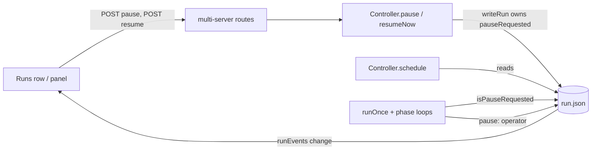

# Design Document

## Overview

This design adds an operator pause to controller runs: a durable `pauseRequested` time on the run record, a `POST /api/controller/runs/:id/pause` route, a Pause button on the Runs page row and panel, and an operator branch in the existing resume route. The hold sits in the controller (`src/controller/controller.ts`) and the run driver (`src/controller/runs.ts`): the driver stops at the step boundaries where the usage window stops a run today, plus the merge-stage entry, and the scheduler never starts a held run.

## Steering Document Alignment

### Technical Standards (tech.md)
No `tech.md`; the design follows `docs/controller-design.md` §8 liveness and §9 usage window and pause (`docs/controller-design.md:168-195`) and the agent-rules checks (`npx tsc --noEmit`, vitest beside each touched module).

### Project Structure (structure.md)
No `structure.md`; every change goes into an existing module, and new tests sit beside the code in existing `__tests__/` directories, as agent-rules "Layout" requires.

### Design System (design-system.md) — if applicable
No `design-system.md`. The new buttons reuse the existing `Button` component (`src/dashboard_frontend/src/modules/ui/ui.tsx:41-61`) and the warning and danger tone classes (`src/dashboard_frontend/src/modules/shell/pause.ts:46-49`).

## Architecture

One new field, `pauseRequested` (ISO time of the click), is the single source of truth for the operator hold; only Resume or the run ending clears it. The applied state is `status: 'paused'`, `pauseReason: 'operator'`, no `resumeAt`; a pause is pending while the field is set and the status is not `paused`. The scheduler, the driver and `onWaitChange` read it, and `writeRun` carries it from disk on every write that does not own it, so a stale driver write cannot drop it (Requirement 2 AC 7).



## Components and Interfaces

### C1 — Run record and `writeRun` (`src/controller/state.ts`)
- **Purpose:** Store the hold durably and keep it across stale writes.
- **Interfaces:**
  - `RunRecord.pauseRequested?: string` — ISO time of the request, set while held (applied or pending), beside `pauseReason`, `resumeAt` and `pausedAt` (`src/controller/state.ts:81-90`).
  - `export const OPERATOR_PAUSE = 'operator'` — the `pauseReason` value of an applied operator pause. `pauseReason` stays a free string.
  - `writeRun(record: RunRecord, opts?: { ownsPauseRequest?: boolean }): Promise<void>` — the new argument is an optional trailing parameter; every existing call keeps its meaning.
  - `readRunSync(id: string): RunRecord | undefined` — a synchronous read of `run.json` for the driver's per-check reads (C3). It returns `undefined` for a missing or unparsable file.
- **Post-conditions of `writeRun`:**
  1. Writes for one run id are serialised in-process, in call order: each write reads the record on disk and writes inside the same serialised section. The controller is the only writer process (`src/controller/state.ts:4`), so an in-process chain per id is sufficient.
  2. Without `ownsPauseRequest`, the written `pauseRequested` is the value on disk, whatever the incoming record carries.
  3. With `ownsPauseRequest: true`, the written `pauseRequested` is the incoming record's value (set or absent).
  4. When `status` is `done`, `abandoned` or `error`, `pauseRequested` is absent whatever the options. This drops a pending pause when a run ends or is cancelled (Requirement 2 AC 5, Requirement 3 AC 5).
  5. The `pausedAt` rule is unchanged (`src/controller/state.ts:388-394`).
- **Reuses:** `writeJsonAtomic` (`src/controller/state.ts:322-327`), so a crash leaves the old record or the new one (NFR Reliability).

### C2 — The pause route and resume branch (`src/dashboard/multi-server.ts`)
- **Purpose:** Expose pause beside cancel, resume and discard.
- **Interfaces:** `POST /api/controller/runs/:id/pause`, registered next to the cancel route (`src/dashboard/multi-server.ts:807-813`). It calls `controller.pause(id)`: `undefined` → `404 { error: 'run-not-found' }`; `null` → `409 { error: 'not-pausable' }`; a record → `200 { ok: true }`. The resume route (`src/dashboard/multi-server.ts:815-822`) is unchanged; its new behaviour comes from `resumeNow` (C4).
- **Dependencies:** `makeRequireAccess` already guards every non-GET under `/api/controller/` (`src/controller/access.ts:186-208`); no exemption is added (Requirement 1 AC 6, NFR Security).
- **Reuses:** the resume route's three-way handler shape (`undefined` → 404, `null` → 409, record → 200) and its 404 body.

### C3 — Driver stop points (`src/controller/runs.ts`)
- **Purpose:** Let the in-flight step finish, act on its result as today, then park the run instead of spawning the next step.
- **Interfaces:**
  - `RunDeps.isPauseRequested?(runId: string): boolean` — optional, so test-built `RunDeps` fakes still compile (`src/controller/runs.ts:388-411`). The controller wires it in `runDeps` (`src/controller/controller.ts:438-453`) as `readRunSync(id)?.pauseRequested !== undefined`. This mirrors `windowBlock`, which reads `rate-limit.json` synchronously on every check (`src/controller/controller.ts:408-423`). Absent means "never held".
  - `pause(deps, run, reason, resumeAt?)` (`src/controller/runs.ts:539-542`) keeps its signature. New post-condition: when `deps.isPauseRequested?.(run.id)` is true, it writes `pauseReason: 'operator'` and no `resumeAt`, whatever `reason` and `resumeAt` the caller passed. Every usage-limit and usage-window pause therefore becomes an operator pause while the operator holds the run (Requirement 2 AC 6).
  - A shared stop reason for the phases: `cancelled` first, then `operator` when `isPauseRequested`, then `usage-window` when `windowBlock().blocked`, else `null`. It replaces the three inline `shouldStop` lambdas (`src/controller/runs.ts:933`, `src/controller/runs.ts:964`, `src/controller/runs.ts:982`).
- **Stop points, and what each one writes:**
  1. **`runOnce` loop top** (`src/controller/runs.ts:804-806`): after the cancel check and before the merge resume, the token cap and the window check, a held run calls `pause(deps, run, OPERATOR_PAUSE)` and returns. When `resumingMerge` is true it first saves the `merge` cursor (C5). This is the boundary for every routed phase, and it covers a run re-driven after a restart (Requirement 5 AC 3, AC 4).
  2. **Implementation, retrospective and close-out:** the existing `shouldStop` calls, unchanged in place (for example `src/controller/phases/implementation.ts:571-573`, `src/controller/phases/retrospective.ts:192-193`, `src/controller/phases/closeout.ts:380-381`), now also return `operator`. These are the points where a usage-window stop already ends each phase and resumes exactly.
  3. **Merge-fix round:** in the `blocked` branch of `runMergeStageStep`, after the cancel guard and before the cap and window guards (`src/controller/runs.ts:692-710`), a held run calls `pause(deps, run, OPERATOR_PAUSE)` and returns `stop`. The `merge` cursor is already saved there (`src/controller/runs.ts:689-691`).
  4. **Merge-stage entry:** the implementation phase exits into the merge stage by a direct call (`src/controller/runs.ts:947`) that bypasses the loop top, so `runMergeStageStep` checks the hold first, after its `hasMerged` early return (`src/controller/runs.ts:624`): a held run saves the `merge` cursor (C5) and calls `pause(deps, run, OPERATOR_PAUSE)`, returning `stop` before `runMergeStage` merges the PR (`src/controller/runs.ts:663-675`). This also covers the merge resume at `src/controller/runs.ts:811`, and stops a held run auto-merging its PR when its last implementation step finishes (Requirement 7 AC 1).
  5. **Document phase:** C6.
- **Outcome handlers:** a `stopped` outcome with reason `operator` calls `pause(deps, run, OPERATOR_PAUSE)` and returns `stop` in `handleImplementationOutcome` (`src/controller/runs.ts:1127-1132`), `handleRetrospectiveOutcome` (`src/controller/runs.ts:1188-1191`), `handleCloseoutOutcome` (`src/controller/runs.ts:1045-1048`) and `handleDocumentOutcome` (C6). `cancelled` and `usage-window` keep their branches.
- **Reuses:** the phases' `shouldStop` seam (`src/controller/phases/implementation.ts:100-104`) and `stepLifecycle`, which clears `inFlight` when each step ends (`src/controller/runs.ts:426-437`).

### C4 — Controller: pause, resume, scheduler, waits, recovery (`src/controller/controller.ts`)
- **Purpose:** Apply the hold at once where no step can be in flight, keep held runs from starting, and end the hold on Resume.
- **Interfaces:**
  - `Controller.pause(runId: string): Promise<RunRecord | null | undefined>` — `undefined` = no such run; `null` = status `done`, `abandoned` or `error`; otherwise the record. Post-conditions:
    1. When `pauseRequested` is already set, nothing is written and the record is returned (Requirement 1 AC 5).
    2. Otherwise one `writeRun` with `ownsPauseRequest: true` sets `pauseRequested` to now. When no drive holds the run (`this.active`, `src/controller/controller.ts:75`) and the status is `queued`, `paused` or `merging`, the same write applies the pause: `status: 'paused'`, `pauseReason: 'operator'`, `resumeAt` absent, `inFlight` absent. For a `merging` run it also writes the `merge` cursor (C5). In every other case (`running`, `waiting`, or a run a drive holds) the pause is pending.
    3. The write emits `runEvents` `change` (Requirement 1 AC 7). The method then calls `void this.schedule()` and returns without waiting on a step, a signal or `gh` (Requirement 1 AC 2, NFR Performance).
  - `Controller.resumeNow(runId)` (`src/controller/controller.ts:207-224`) gains a first branch for a held run (`pauseRequested` set):
    1. Applied (`status: 'paused'`, `pauseReason: 'operator'`): one owned write of `status: 'queued'`, with `pauseRequested`, `pauseReason` and `resumeAt` absent. The status is `queued`, so the existing window-blocked branch parks the run as `usage-window` when a window is full (Requirement 4 AC 3), and the existing startable path starts it otherwise. `rate-limit.json` is not touched.
    2. Pending (any other status): one owned write that clears only `pauseRequested`; the run carries on (Requirement 4 AC 4).
    3. Then `void this.schedule()` and return the record.
    A run with no `pauseRequested` takes today's path unchanged (Requirement 4 AC 5, AC 6).
  - `Controller.save(run, patch, opts?: { ownsPauseRequest?: boolean })` (`src/controller/controller.ts:524-529`) passes `opts` through to `writeRun`.
- **Scheduler changes** (`src/controller/controller.ts:298-345`):
  1. `isStartable` returns `false` for any run with `pauseRequested`, before its status checks. This blocks the recovery half of Requirement 3 AC 6 and the restart case in Requirement 5 AC 2.
  2. A settle pass runs first in `schedule`, before the window check, for every held run that no drive holds and whose status is `queued`, `merging`, or `paused` with a reason other than `operator`. It writes the applied pause, with the `merge` cursor for `merging`. This parks a run that became idle after the route marked it pending (for example a merge re-check that ended `not-ready`).
- **Waits** (`src/controller/controller.ts:369-392`): when an answered wait finds the run held, the run becomes `status: 'paused'`, `pauseReason: 'operator'`, with `resumeAt` absent, instead of `queued`. The answer itself is written as today. An `abandon` answer still cancels, and C1 post-condition 4 drops the hold (Requirement 3 AC 4, AC 5). `recover` reaches the same code through `resumeIfWaitAnswered` (`src/controller/controller.ts:291-294`), which covers Requirement 5 AC 5.
- **Recovery** (`src/controller/controller.ts:261-274`): no code change. A held `paused` run is never startable (item 1); a held `running` run, re-attached or re-driven, reaches the loop-top stop (C3 point 1) before any spawn.
- **Dependencies:** C1, C3.
- **Reuses:** `save`, `isLive` (`src/controller/controller.ts:532-536`), `schedule`, `onWaitChange`.

### C5 — Merge re-entry marker
- **Purpose:** Resume a run paused from the merge stage into the merge stage, not into the implementation phase (Requirement 3 AC 3, Requirement 4 AC 2).
- **Interfaces:** when a pause is applied at the merge stage — by the route or settle pass on a `merging` run, the loop-top stop while `resumingMerge`, or the merge-stage-entry stop on a run completing implementation (C3 point 4) — the same write sets `cursor: { phase: run.phase ?? 'implementation', stepKind: 'merge', attempt: 1 }`. This is the cursor the `blocked` path already sets (`src/controller/runs.ts:689-691`), and `runOnce` reads it in its merge-resume check (`src/controller/runs.ts:778-781`). For a close-out merge, `hasMerged` is already true, so the cursor is inert and routing returns to the close-out merge step (`src/controller/runs.ts:850-858`).
- **Reuses:** the existing merge-resume detection.

### C6 — Document phase stop (`src/controller/phases/document.ts`)
- **Purpose:** Give the document phase its first stop check (`src/controller/phases/document.ts:159-198`).
- **Interfaces:**
  - `DocumentPhaseContext.shouldStop?: () => string | null` — optional. `runOnce` passes `() => (deps.isPauseRequested?.(runId) ? 'operator' : null)` on the main call (`src/controller/runs.ts:906-913`) and on the fresh retry (`src/controller/runs.ts:1242-1249`).
  - `DocumentPhaseOutcome.result` gains `'stopped'` (`src/controller/phases/document.ts:200-213`).
  - The check runs once, at the top of each review round in the rounds loop (`src/controller/phases/document.ts:802-806`), before the adversarial prompt is built and before the reviewer spawns. A non-null reason returns `{ result: 'stopped', version: D, rounds: reviewRounds, reason }`.
- **Why only there:** the phase resumes from the latest document version, not from a step (the drafter runs only when `D === 0`, `src/controller/phases/document.ts:771`). At the round top every step for the current version has committed, so re-entry starts with that version's reviewer and no step runs twice. A stop before a mid-round step would re-run the reviewer or skip the lint fix on resume, breaking Requirement 4 AC 1; those steps run to the round's end (D3, Scope notes).
- **`handleDocumentOutcome`** (`src/controller/runs.ts:1209-1262`): a `stopped` outcome calls `pause(deps, run, OPERATOR_PAUSE)` and returns `stop`. Before the fresh retry (`src/controller/runs.ts:1239-1249`), a held run calls the same pause and returns `stop`, without bumping the attempt. Re-entry on Resume then runs the phase fresh, and that run takes the place of the retry.
- **Reuses:** the existing `step.error` early-return pattern; every call site returns the outcome before it reads `step.result` (for example `src/controller/phases/document.ts:823-827`).

### C7 — Wire row and frontend type
- **Purpose:** Tell the frontend a pending pause from an applied one (Requirement 6 AC 7).
- **Interfaces:** `ControllerRunRow.pauseRequested?: string`, which `toRow` copies from the record (`src/controller/runs.ts:1336-1363`), and the same optional field on the frontend `ControllerRun` (`src/dashboard_frontend/src/modules/shell/types.ts:215-231`). The field is an ISO time, so no path reaches the wire (NFR Security).

### C8 — Pause note (`src/dashboard_frontend/src/modules/shell/pause.ts`)
- **Purpose:** Say which kind of pause a run has, in the operator's words.
- **Interfaces:**
  - `isOperatorHeld(run: ControllerRun): boolean` — `run.pauseRequested !== undefined || (run.status === 'paused' && run.pauseReason === 'operator')`.
  - `pauseNote(run, now)` (`src/dashboard_frontend/src/modules/shell/pause.ts:27-44`) gains two cases, tested before today's logic:
    1. Applied (`status: 'paused'`, `pauseReason: 'operator'`): text `paused by you` plus the age from `pausedAt` (for example `paused by you 12m 4s`). There is no `resumes in` or `overdue` part, and `overdue` is false (Requirement 6 AC 4).
    2. Pending (`pauseRequested` set, status not `paused`): for a `waiting` run, today's waiting note with ` · pause requested` appended; for a `running`, `queued` or `merging` run, the text `pause requested` (Requirement 6 AC 3).
    Usage pauses and plain waits keep today's text (Requirement 6 AC 5).
- **Reuses:** `fmtSpan`, `pauseNoteClass`. The Now page renders `pauseNote` already (`src/dashboard_frontend/src/modules/shell/NowPage.tsx:351-352`), so it picks up both texts with no change.

### C9 — Runs page row and panel (`src/dashboard_frontend/src/modules/shell/RunsPage.tsx`)
- **Purpose:** Pause and Resume buttons (Requirement 6 AC 1 to AC 4).
- **Interfaces:**
  - `PauseButton({ run })` — local to `RunsPage.tsx`, owning its `busy` and `error` state. On click it calls `e.stopPropagation()` (the shell already uses it at `src/dashboard_frontend/src/modules/shell/Sidebar.tsx:197`), then posts to the pause route. While busy it reads `Pausing…` and is disabled. A failure shows `pause failed (status)` beside the button as a danger-tone span with `role="alert"`, and never selects the row or opens the panel. The new state arrives over the runs topic (`src/dashboard_frontend/src/modules/shell/RunsPage.tsx:260-271`).
  - Row (`src/dashboard_frontend/src/modules/shell/RunsPage.tsx:209-233`): renders `PauseButton` (test id `ctrl-row-pause-<id>`) when the status is live (`queued`, `running`, `paused`, `waiting` or `merging`) and `isOperatorHeld` is false. The row shows no Resume.
  - Panel (`src/dashboard_frontend/src/modules/shell/RunsPage.tsx:235-324`): renders `PauseButton` (test id `ctrl-pause`) under the same condition as the row. When `isOperatorHeld` is true, it shows a **Resume** button (test id `ctrl-resume-operator`) that posts to the resume route, and it hides **Resume now**. **Resume now** (`ctrl-resume`, `src/dashboard_frontend/src/modules/shell/RunsPage.tsx:296-306`) stays for a `paused` run that is not held. Cancel and Discard are unchanged.
- **Reuses:** `Button`, the panel's `resume` handler shape, and the panel error line (`src/dashboard_frontend/src/modules/shell/RunsPage.tsx:321`) for Resume failures.

### C10 — `scripts/sdd-self-update.sh`
- **Purpose:** none; no change (D8). An applied pause clears `inFlight` and `step_live` counts only live processes (`scripts/sdd-self-update.sh:89-97`), so a paused run passes the in-flight check and the pre-swap/restart waits (`scripts/sdd-self-update.sh:297-308`).

## Data Models

### RunRecord (additions only)
```
pauseRequested?: string   // ISO time of the operator's pause request; set while held (pending or applied)
pauseReason?: string      // existing; 'operator' (OPERATOR_PAUSE) for an applied operator pause
```

### States of a held run
| `pauseRequested` | `status` | `pauseReason` | Meaning |
|---|---|---|---|
| set | `paused` | `operator` | applied operator pause; no `resumeAt`, no `inFlight` |
| set | `running` / `waiting` | any | pending; parks at the next stop point or wait answer |
| set | `queued` / `merging` / `paused` (other reason) | any | pending for one scheduler pass at most; the settle pass applies it |
| absent | `paused` | `operator` | a hold withdrawn mid-write; the run is startable, and `schedule` clears the reason and starts it |

### ControllerRunRow / ControllerRun (addition)
```
pauseRequested?: string   // ISO; absent unless the operator holds the run
```

## Error Handling

1. **Pause on an unknown, terminal or already-held run:** 404 `run-not-found`, 409 `not-pausable` (record unchanged), or 200 with no write.
2. **A driver write spreads an older record after the route wrote:** C1 post-condition 2 keeps `pauseRequested`; a status or reason the stale write overwrites is re-applied by the next stop point or the settle pass.
3. **A row Pause fails:** the inline error shows `pause failed (status)`; the row stays unselected and the panel closed.
4. **Resume lands between the driver's stop decision and its pause write:** the record ends `paused`/`operator` with no hold, which is startable (last table row), so the scheduler starts the run on its next tick.

## Testing Strategy

A test seeding a held record either passes `writeRun` `{ ownsPauseRequest: true }` (post-condition 2 drops it otherwise) or writes `run.json` directly, as `e2e/worktree-shell.spec.ts:164-173` does.

- **Unit:**
  - New `src/controller/__tests__/pause-request.test.ts` (vitest). A normal `writeRun` keeps an on-disk `pauseRequested`. An owned write sets and clears it. A terminal status drops it. A stale normal write and an owned write started together through `Promise.all` end with the field set. `readRunSync` returns the record, or `undefined` for a missing file. `src/controller/__tests__/paused-at.test.ts:13-38` stays green unchanged.
  - `src/controller/phases/__tests__/document.test.ts`: with `shouldStop` returning `operator`, the phase returns `stopped` at the first round top, and the stub records no reviewer spawn. With `shouldStop` unset, today's tests pass unchanged.
  - `src/controller/__tests__/runs.test.ts`: `runOnce` on a `running` record with `pauseRequested` set writes `paused`/`operator` and spawns no step. With `isPauseRequested` true, a step that classifies `usage-limit` ends as an operator pause with no `resumeAt`. This extends the usage-limit test near `src/controller/__tests__/runs.test.ts:348-349`.
- **Integration** (`src/controller/__tests__/controller.test.ts`, the stub `claude` with `delayMs`, `scripts/stub-claude.mjs:17`, `scripts/stub-claude.mjs:110-111`):
  - Pausing a run whose step is in flight (a delayed stub step) answers before the step ends; the step's result is acted on, and the run ends `paused`/`operator` with no `inFlight` and no further stub run consumed. When that in-flight step is the last implementation step and the PR is immediately mergeable, the PR stays unmerged and the run ends `paused`/`operator` with the `merge` cursor set (Requirement 7 AC 1).
  - Pausing a `queued` run applies at once and `pump()` does not start it. Pausing a usage-paused run replaces the reason and clears `resumeAt`. Pausing a `merging` run applies at once with the `merge` cursor, and Resume re-enters the merge stage without an implementation step.
  - Pausing a `waiting` run leaves it pending; answering the wait makes it `paused` with reason `operator`. An `abandon` answer on an error wait abandons it and drops the field.
  - A window over the threshold, then recovered, leaves an operator-paused run paused. This extends the window tests at `src/controller/__tests__/controller.test.ts:235-295`; the existing `resumeNow` assertions there stay exact.
  - Resume of an applied pause starts the next step. Resume under a full window leaves it `paused`/`usage-window`, `rate-limit.json` unchanged. Resume of a pending pause clears the field and the run carries on.
  - Restart: `start()` on held records seeded `paused`/`operator`, `running` with a dead pid, and `waiting` with an answered wait leaves all three `paused`/`operator` with no step spawned, after the pattern of `src/controller/__tests__/controller.test.ts:414-449`.
  - Routes (`src/dashboard/__tests__/controller-dashboard-routes.test.ts`): pause 404, 409 `not-pausable`, idempotent 200; regression guards for the 401 without the secret and resume 409 `not-paused`.
- **End-to-end:**
  - `e2e/worktree-shell.spec.ts` (Playwright, worktree config): seed a `running` run, click the row Pause, check the row stays unselected and no panel opens. Seed a `paused`/`operator` run, check the row and panel read `paused by you` and the panel shows Resume, not Resume now. A seeded usage-window run still shows Resume now (regression guard).
  - The deploy scenario (pause a live run, run `scripts/sdd-self-update.sh`, restart, Resume) needs the live controller service, so it stays a pending line in a tracked `verification-evidence.md` that the operator runs in a rebuilt, restarted session (agent-rules "Fixtures and live verification").

## Decisions taken in this document

- D1 — The hold is one durable time field on the run record, separate from status and reason: it survives a restart, leaves the status union and its consumers unchanged, and lets status and reason stay the applied view.
- D2 — Run-record writes for one id are serialised in-process and carry the hold from disk unless the writer owns it: one choke point covers every stale spread (driver, controller, cancel), and the controller is the only writer process.
- D3 — The run stops at the points where the usage window already stops it, plus the driver loop top and the merge-stage entry, and the document phase stops only at a review-round top: the phases resume exactly from these points, while a stop before a mid-round document step would re-run the reviewer or skip the lint fix on resume. RE-DECIDED against the literal of Requirement 2 AC 3.
- D4 — The pause helper turns any pause into an operator pause while the run is held: every usage-limit and usage-window path already goes through it.
- D5 — Resume of an applied operator pause writes the queued status: the existing window-blocked branch then parks it as a usage-window pause and the existing start path starts it, with no new scheduler branch.
- D6 — The route applies the pause at once only to an idle queued, paused or merging run, and a scheduler settle pass parks held runs that become idle later: a queued or merging run has no driver to apply it.
- D7 — The document-phase stop check reads only the operator hold, not the usage window or cancel: so the usage-window behaviour of the document phase does not change, as the requirements state.
- D8 — The self-update script stays as it is and does not pause runs itself: the operator flow already passes its in-flight check, the script would need the controller secret and an HTTP client, and a failed deploy would leave every run held with nobody to resume it.
- D9 — A failed row Pause shows a short inline error beside the button, which owns its own busy and error state (a page-level message or opening the panel is ruled out by Requirement 6 AC 2): it needs no new shared surface and keeps the row's click behaviour.
- D10 — The pending note is "pause requested" (appended to the waiting note for a waiting run) and the applied note is "paused by you" plus the age: a status chip was rejected because the chip must keep showing the real status while the step or wait completes.
- D11 — The driver reads the hold from disk on each check: one source of truth, as the window check already reads its file on every check.

## Scope notes

- Carried items from requirements: none.
- RE-DECIDED (D3): Requirement 2 AC 3 names each document-phase step as a boundary; this design parks the document phase only at a review-round top, so the reviewer, reviser, lint-fix, narrow-check and adjudicator steps of a round run on, and a pause can wait up to one round (an approval can land first). The other phases park at their existing `shouldStop` points. A step-exact document resume is out of scope.
- Re-entry after a document-phase pause loses that phase's in-memory round state (standoff and circling history, the cap's extra round), as a usage-limit re-entry does today.
- Decided here, as the decomposition asks: the self-update script (D8), the row error location (D9), and how waits opened under a pending pause display (D10, C8).
- Out of scope, as the requirements set: the advisor second-opinion step, a pause timer, pausing every run with one click, and any change to cancel or discard.

## Revision History

- **v1** (2026-10-29) — Initial draft.
  - **Lint pass.** 1 fixed (L-39: dropped unresolvable `node_modules/@types/react` citation, line 123); rejected L-1 to L-38, L-40 to L-62 as false positives.
- **v2** (2026-10-29) — Round-1 adversarial response (adversarial-analysis-design.md, verdict iterate 0/1/2).
  - **R1-1 — Accepted (SHOULD_FIX).** Added a merge-stage-entry stop (line 66): a run held on its last implementation step now pauses and saves its merge cursor before the merge runs, instead of auto-merging its pull request. Also corrected the loop-top boundary wording (line 63), the cursor-setting list (line 94), D3 and the Overview, and added a Testing Strategy case (line 169).
  - **R1-2 — Accepted (MINOR).** The reuse line now cites the resume route's three-way shape, not the cancel route (line 54).
  - **R1-3 — Rejected (MINOR).** The per-check disk read is already stated and justified against the window check's precedent in point 1 and D11; nothing to add.
  - **Lint pass.** 0 fixed; rejected: L-1 to L-61 citation-identifier false positives (every cited range verified accurate; flagged tokens are new symbols, status/return values, enclosing function names, or anchored to a different clause on the line).
